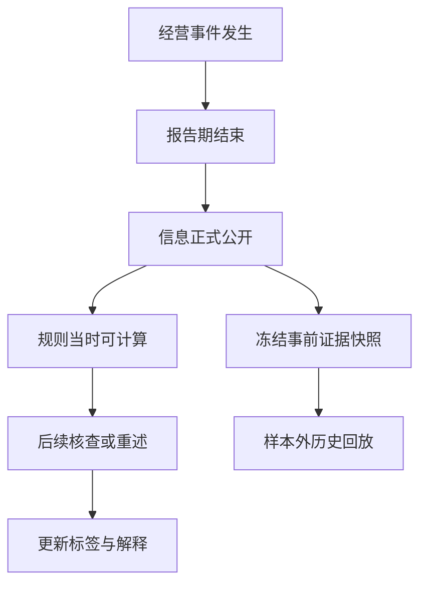
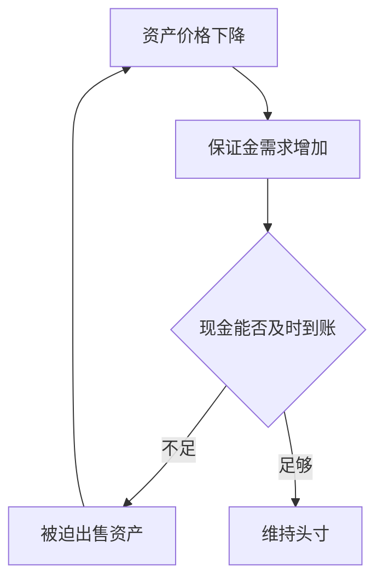
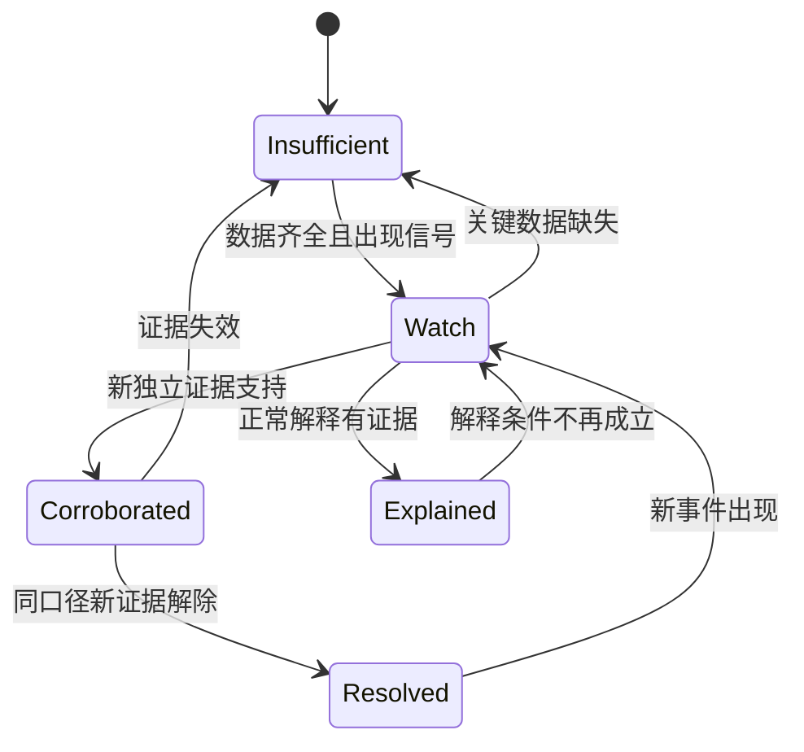
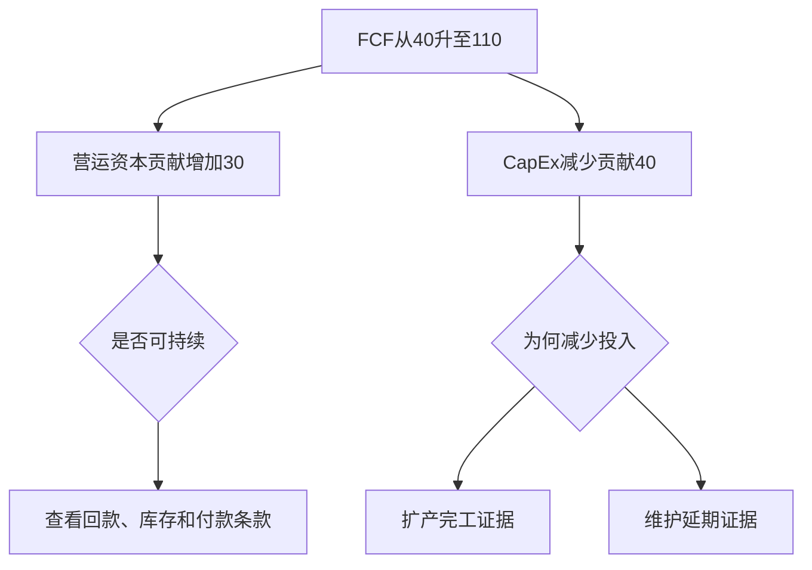
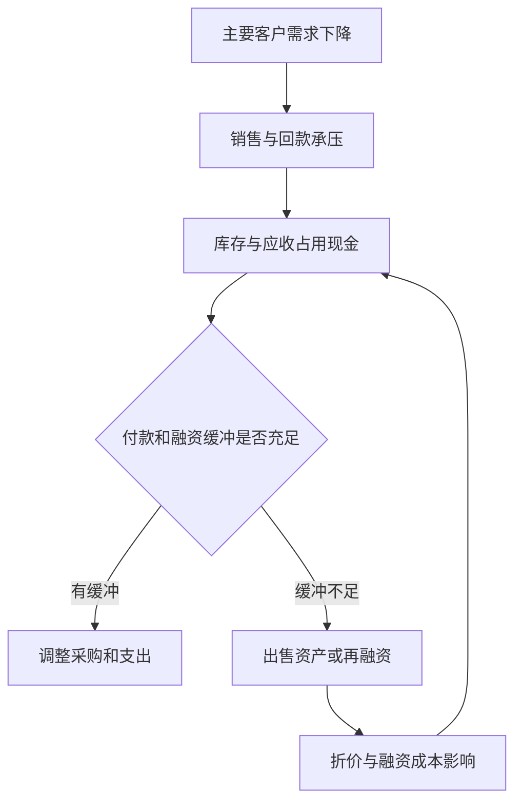
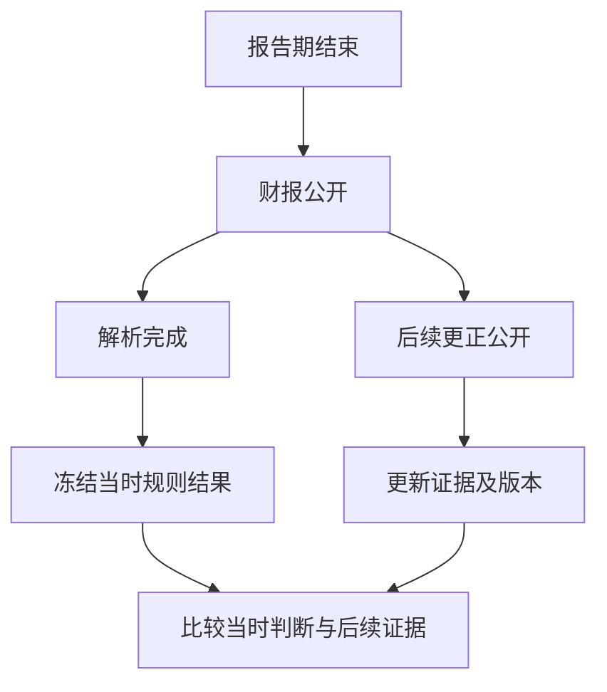
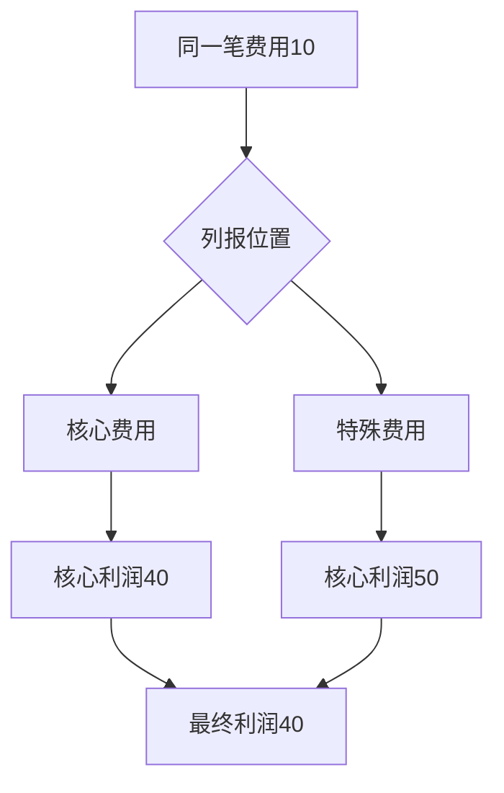
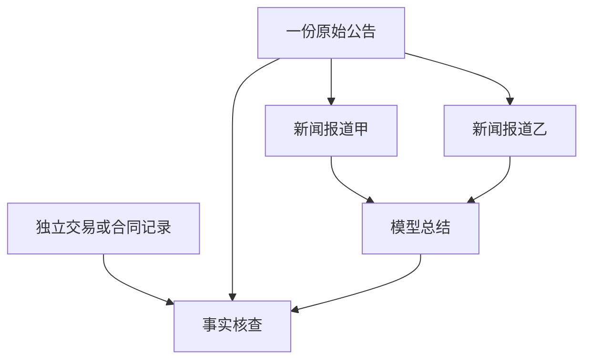
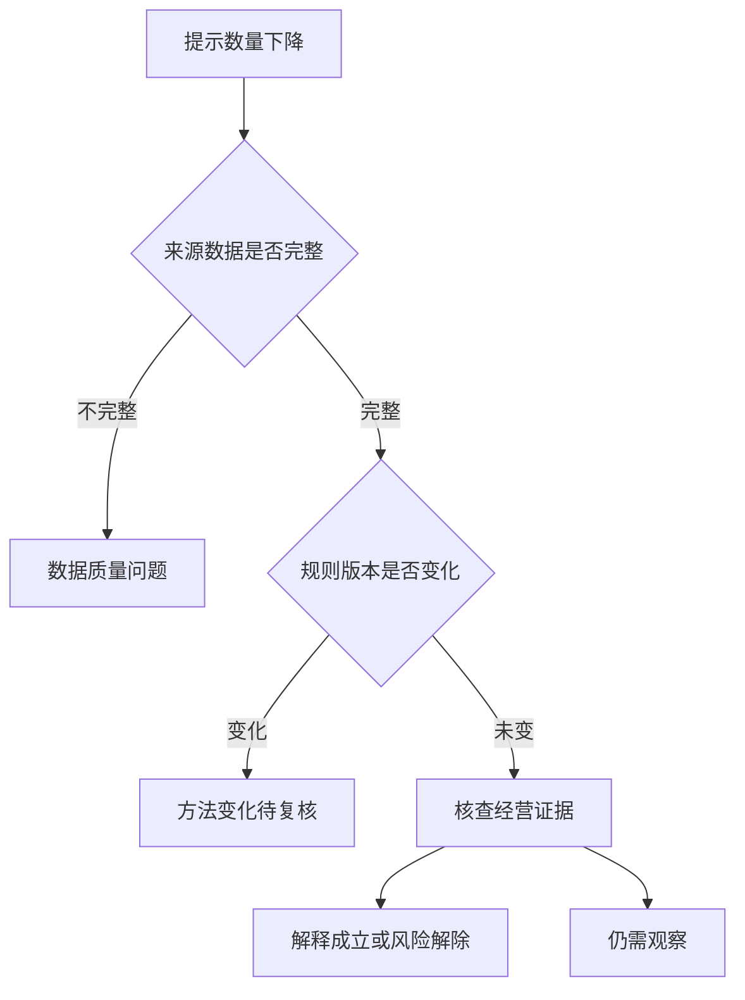

# Filing Flows 陷阱研究第二卷：论文、商业案例与新检测假设

日期：2026-11-05｜版本：4.0｜独立第二份文件｜研究设计，不代表功能已上线。

## 当前版本导航

**v4.0重点：把研究目录转换成可解释的图形、可执行的数据契约与可验收的产品流程。** 本次保留27篇论文、34个案例条目、100项研究假设；不以重复分类增加总数，也不新增未核实公司事实。

| 需要解决的问题 | 阅读位置 |
|---|---|
| 学术依据及局限 | 第1、11、25节 |
| 真实案例和法律状态 | 第2、26节 |
| 研究假设 | 第5、12、28节 |
| 模型与开发规则 | 第16、29节 |
| 本次新增图形及样例 | 第33–39节 |
| 用户分析路径与实施验收 | 第40–43节 |

历史版本章节保留用于追踪，当前总量以上述说明为准。文中的建议、原型和测试标准均不代表生产网站已实施。

## 阅读边界与研究结论

第一卷提供100项陷阱目录；本卷增加论文依据、34个案例条目（含一个财务口径对照案例）、60个明确标为假设的商业情景，以及100个待验证的新检测假设（H01–H100）。真实案例和合成情景分别计数，不能把合成情景称为真实公司案例。本文是定向文献检索与案例综述，不是穷尽性系统综述，也没有完整复现论文。

论文核查层级以题录、作者摘要、出版方页面和公开可读正文片段为主；未逐篇全文审阅、复核所有回归表或重新计算样本。案例依据为链接所示日期的官方材料；“SEC指控”“行政命令认定”“和解”“监管复盘”必须保留，不代表所有个人指控均获刑事定罪，也不代表已核查至今所有诉讼进展。

**核心意见：把陷阱识别拆成数据异常、经济机制、证据强弱、投资含义四层。** 相同异常可能对应舞弊、合法会计估计、经营恶化或健康扩张。不能从单一分数跳到“做空”。

## 1. 论文阅读与开发映射

下列每项均给出公开检索入口；工作论文年份与正式发表年份分别注明。研究发现属于其特定样本，不自动等于今日可交易收益。

### P01｜Sloan，1996

[Do Stock Prices Fully Reflect Information in Accruals and Cash Flows About Future Earnings?](https://papers.ssrn.com/sol3/papers.cfm?abstract_id=2598)

研究要点：盈利中的现金与应计部分持续性不同，市场可能未充分区分。

Filing Flows应用与限制：盈利拆分与后续现金转化；高应计并非舞弊。

### P02｜Beneish，1999

[The Detection of Earnings Manipulation](https://rpc.cfainstitute.org/research/financial-analysts-journal/1999/the-detection-of-earnings-manipulation)

研究要点：用财务报表失真特征及激励条件筛选操纵风险。

Filing Flows应用与限制：M-score只用于筛查；结构变化也能造成高分。

### P03｜Dechow、Ge、Larson、Sloan，2011

[Predicting Material Accounting Misstatements](https://onlinelibrary.wiley.com/doi/10.1111/j.1911-3846.2010.01041.x)

研究要点：以SEC执法样本研究错报特征并建立F-score。

Filing Flows应用与限制：这是错报F-score，不是Piotroski财务强度F-score；执法选择偏差需要控制。

### P04｜Novy-Marx，2013；工作论文2010

[The Other Side of Value: The Gross Profitability Premium](https://www.nber.org/papers/w15940)

研究要点：毛利润相对资产的信息可补充价值指标。

Filing Flows应用与限制：建立估值×盈利质量对照；不能把历史溢价写成保证回报。

### P05｜Roychowdhury，2006

[Earnings Management through Real Activities Manipulation](https://www.sciencedirect.com/science/article/pii/S0165410106000401)

研究要点：研究折扣促销、过量生产、削减可自由裁量支出等真实活动操纵。

Filing Flows应用与限制：异常经营残差不证明管理层意图；需求冲击也可解释。

### P06｜Dechow、Dichev，2002；公开稿2001

[The Quality of Accruals and Earnings: The Role of Accrual Estimation Errors](https://papers.ssrn.com/sol3/papers.cfm?abstract_id=277231)

研究要点：用应计与现金流匹配中的估计误差研究盈利质量。

Filing Flows应用与限制：原始框架涉及未来现金流；实时模型必须滞后或重设，不能前视。

### P07｜Piotroski，2000

[Value Investing: The Use of Historical Financial Statement Information to Separate Winners from Losers](https://www.ivey.uwo.ca/media/3775523/value_investing_the_use_of_historical_financial_statement_information.pdf)

研究要点：用历史财务信息区分高账面市值比股票的财务强弱。

Filing Flows应用与限制：原始股票池限制很重要；不应机械套用所有成长股。

### P08｜Loughran、McDonald，2011

[When Is a Liability Not a Liability? Textual Analysis, Dictionaries, and 10-Ks](https://onlinelibrary.wiley.com/doi/10.1111/j.1540-6261.2010.01625.x)

研究要点：通用负面词典在金融语境下可能误判。

Filing Flows应用与限制：保留否定、条件句、章节和上下文；liability不是自动负面。

### P09｜Harvey、Liu、Zhu，2016；工作论文2014

[… and the Cross-Section of Expected Returns](https://www.nber.org/papers/w20592)

研究要点：多重测试影响因子发现的显著性门槛。

Filing Flows应用与限制：登记全部规则和调参尝试；不把固定t值阈值当通用真理。

### P10｜Hou、Xue、Zhang，2020；工作论文2017

[Replicating Anomalies](https://www.nber.org/papers/w23394)

研究要点：系统复核大量异常，检验对微盘股、权重与统计设定敏感性。

Filing Flows应用与限制：工作稿和最终稿变量数有差异；引用结果时锁定版本。

### P11｜Bailey、Borwein、López de Prado、Zhu；公开稿2015

[The Probability of Backtest Overfitting](https://papers.ssrn.com/sol3/papers.cfm?abstract_id=2326253)

研究要点：研究策略选择与样本外退化，提出回测过拟合概率框架。

Filing Flows应用与限制：需要候选策略集合；PBO不等于未来亏损概率。

### P12｜Bailey等，2014

[Pseudo-Mathematics and Financial Charlatanism: The Effects of Backtest Overfitting on Out-of-Sample Performance](https://scholarworks.wmich.edu/math_pubs/40/)

研究要点：少量策略配置搜索也能产生很漂亮的模拟结果。

Filing Flows应用与限制：保存失败实验和搜索次数；不能只存赢家。

### P13｜DellaVigna、Pollet；NBER工作论文2005

[Investor Inattention, Firm Reaction, and Friday Earnings Announcements](https://www.nber.org/papers/w11683)

研究要点：研究注意力与财报信息反应不足。

Filing Flows应用与限制：公告时点可能内生；不是逢周五财报必买的规则。

### P14｜Jensen、Kelly、Pedersen，2023

[Is There a Replication Crisis in Finance?](https://onlinelibrary.wiley.com/doi/10.1111/jofi.13249)

研究要点：提供与悲观复现结论不同的证据及方法讨论。

Filing Flows应用与限制：研究比较要统一风险调整、因子定义与样本；不要只选支持自己观点的论文。

## 2. 首批真实案例索引：22个条目

下表事实按来源当时的表述缩写；检测方法、图表和正常解释是本报告的分析建议。案例条目不是22个独立统计样本：同一事件可能拆成多个机制，训练时必须按事件家族去重。

| ID / 案例 | 官方材料描述的机制及状态 | 研究应用与正常解释 | 可视化 / 来源 |
|---|---|---|---|
| C01 WorldCom | SEC 2002年起诉材料涉及不当会计及费用资本化，掩盖经营成本。 | 资本化与经营费用共同追踪；合法长期资产支出是反例。 | 费用→资产→利润桥；[官方材料](https://www.sec.gov/litigation/complaints/complr17588.htm) |
| C02 Xerox | SEC 2002年诉状指控提前确认设备收入，和解要求重述等。 | 合同分配和确认时点；真实租赁组合改变可解释部分变化。 | 合同现金/收入双时间线；[官方材料](https://www.sec.gov/litigation/complaints/complr17465.htm) |
| C03 Sunbeam | SEC历史行政材料涉及渠道压货等会计问题。 | 季末发货与后续退货；旺季备货不自动构成压货。 | 发货/回款/退货图；[官方材料](https://www.sec.gov/enforcement-litigation/administrative-proceedings/33-7976) |
| C04 Bristol-Myers Squibb | SEC 2004年案件材料指控过量渠道库存及相关不当收入确认。 | 渠道库存和终端需求；渠道数据缺失须标未知。 | sell-in与sell-through图；[官方材料](https://www.sec.gov/enforcement-litigation/litigation-releases/lr-18820) |
| C05 Kraft Heinz | SEC 2021年命令涉及未赚取供应商折扣和不当成本节约，公司和解。 | 采购节约与合同条件核验；真实规模折扣是反例。 | 采购节约贡献桥；[官方材料](https://www.sec.gov/newsroom/press-releases/2021-174) |
| C06 Under Armour | SEC 2021年命令涉及提前发运订单影响增长而未充分披露，公司和解。 | 区分收入确认和增长来源披露问题；客户主动提前收货可正常。 | 季度间收入迁移图；[官方材料](https://www.sec.gov/newsroom/press-releases/2021-78) |
| C07 Dell | SEC 2010年案件指控未披露Intel款项对盈利的作用及准备金会计问题。 | 核心盈利对供应商支持依赖；公开透明返利并非不当。 | 主业/供应商支持利润桥；[官方材料](https://www.sec.gov/enforcement-litigation/litigation-releases/lr-21599) |
| C08 GE Power利润 | SEC 2020年命令涉及成本估计下调对利润的贡献披露不足。 | 估计变更和真实效率分开；项目成本确实下降是反例。 | 项目估计变更利润桥；[官方材料](https://www.sec.gov/newsroom/press-releases/2020-312) |
| C09 GE现金来源 | 同一SEC 2020年命令指出工业现金收取增长与内部应收销售有关。 | 分部现金与合并现金分开；内部转移不是集团新增现金。 | 集团现金抵销图；[官方材料](https://www.sec.gov/newsroom/press-releases/2020-312) |
| C10 Luckin Coffee | SEC 2020年诉状指控通过关联方虚构销售等，公司同意和解。 | 业务量与交易真实性；公开报表无法替代银行与订单函证。 | 门店/订单/现金交叉图；[官方材料](https://www.sec.gov/newsroom/press-releases/2020-319) |
| C11 Diamond Foods | SEC 2014年案件指控把核桃成本推迟到后续期间。 | 付款、收货、费用归属分开；正常预付款不能误判。 | 采购成本跨期桥；[官方材料](https://www.sec.gov/newsroom/press-releases/2014-4) |
| C12 Newell Brands | SEC 2023年命令涉及核心销售增长披露与提前销售等，公司和解。 | 非GAAP增长定义和实际趋势；明确披露的季节调整可正常。 | 增长口径版本图；[官方材料](https://www.sec.gov/newsroom/press-releases/2023-210) |
| C13 Valeant | SEC 2020年命令涉及收入确认与误导性GAAP/非GAAP披露，公司和解。 | 渠道控制关系和收入分配；不得把所有并购增长视为问题。 | 公司/渠道/收入网络；[官方材料](https://www.sec.gov/newsroom/press-releases/2020-169) |
| C14 Satyam | SEC 2011年诉状指控虚假发票与银行记录抬高收入和现金，公司和解。 | 账面现金必须有可信证据；利息低只是线索。 | 现金存在性证据树；[官方材料](https://www.sec.gov/enforcement-litigation/litigation-releases/lr-21915) |
| C15 HealthSouth | SEC 2003年诉状指控为达到盈利预期虚增收益及资产。 | 利润与资产同步异常；本条不将对个人的指控写成定罪。 | 盈利与资产质量图；[官方材料](https://www.sec.gov/enforcement-litigation/litigation-releases/lr-18044) |
| C16 Walgreens | SEC 2018年命令涉及未充分披露达到预测盈利目标的风险，公司和解。 | 指引修订和可实现性；预测失误本身不等于违法。 | 指引与实现路径；[官方材料](https://www.sec.gov/newsroom/press-releases/2018-220) |
| C17 Nikola公司 | SEC 2021年公司和解涉及产品、技术与商业前景的误导性陈述。 | 原型、量产、交付和收入分阶段；只描述公司历史和解，不推断个人当前法律状态。 | 技术到商业里程碑图；[官方材料](https://www.sec.gov/newsroom/press-releases/2021-267) |
| C18 Boeing | SEC 2022年命令涉及737 MAX事故后误导投资者的公开陈述，公司和解。 | 安全事件与交付、现金和负债关联；安全风险不能仅靠财务分数覆盖。 | 事件到财务影响图；[官方材料](https://www.sec.gov/newsroom/press-releases/2022-170) |
| C19 Infinity Q | SEC 2023年和解诉讼材料涉及基金NAV错误定价；2022年材料描述修改第三方模型输入。 | 第三方模型不保证输入独立；合理参数调整也可能成立。 | 输入/模型/估值审计链；[官方材料](https://www.sec.gov/enforcement-litigation/litigation-releases/lr-25750) |
| C20 Silicon Valley Bank | 美联储2023年复盘讨论管理和监管未充分应对风险。 | 资产期限、存款集中与流动性一起评估；不是会计舞弊案例。 | 存款流失×资产折价情景；[官方材料](https://www.federalreserve.gov/publications/files/svb-review-20230428.pdf) |
| C21 英国LDI危机 | 英格兰银行2022年报告说明保证金要求与被迫卖债的反馈。 | 经济偿付能力与即时现金能力不同；对冲也可能引发现金压力。 | 保证金—卖出—价格反馈图；[官方材料](https://www.bankofengland.co.uk/financial-stability-report/2022/december-2022) |
| C22 Interface / Fulton案例组 | SEC 2020年执法年报介绍EPS Initiative下两项和解会计案件。 | 小额估计调整与刚好达标；小幅超预期本身不证明操纵。 | EPS阈值附近分布；[官方材料](https://www.sec.gov/files/enforcement-annual-report-2020.pdf) |

### 案例解释的三条限制

- 这是机制学习库，不能由“像某历史案例”直接推断当前公司造假。模型检索应输出“机制相似”，不输出“下一个某公司”。
- 监管案件里的内部邮件、客户证据、银行记录往往当时不公开。必须区分事前可见线索与事后证据；否则会制造虚假的提前预警能力。
- 执法样本偏向被发现、被调查和有管辖权的事件。非执法公司不能自动标为“干净负样本”。

## 3. 六组案例深挖：从故事变成研究任务

### 3.1 GE：现金来源与估计利润

同一来源需要分成两个机制：成本估计改变影响利润；内部应收安排影响分部现金叙述。产品应设置“合并/分部”开关，禁止把分部现金增加等同集团现金增加。证据包括分部附注、应收转让披露、合并抵销与项目估计变化。正常解释是项目实际效率改善或明确披露的内部资金管理。此处不根据官方案件重建未取得的逐季金额。

### 3.2 Under Armour vs Luckin：真实交易前移与虚构交易

前者说明即使存在交易，也可能误导增长持续性；后者涉及交易真实性。分类器至少设置 timing、existence、disclosure 三类。提前发货检测的输入是订单要求日期与实际发运日期，但公众通常拿不到，因此公开版只能提示“增长来源待核查”，不能声称已检测每笔提前发货。

### 3.3 SVB vs LDI：有资产不代表及时拿得到现金

两者都适合研究期限与现金需求错配，但法律结构及负债机制不同。SVB侧重银行资产、存款与风险管理，LDI侧重衍生品/回购保证金和养老金注资速度。统一底层问题是“现金需求到达速度是否快于可用资产转换速度”。压力测试要加入到账、结算与治理审批延迟。

### 3.4 Kraft Heinz vs Diamond Foods：采购端的利润质量

一类涉及折扣确认条件，另一类涉及成本归属期间。图表应把成本按收货期、付款期、合同义务期分解。若合同、订单或采购明细缺失，只能提出问题。单纯毛利率提高不足以触发严重风险。

### 3.5 Infinity Q：独立来源的外观与输入控制权

第三方软件、外部报价、审计意见是不同层次的证据。需要追踪谁选择模型、谁修改参数、谁批准覆盖、是否保存原始报价。公开版无法获得模型日志，应展示证据缺口；机构内部版可做参数变更审计。

### 3.6 Newell、Valeant、Walgreens：管理层叙述与定义漂移

核心销售、有机增长和指引都需要版本管理。提取“指标定义—排除项—期间—适用业务—前期可比性”。正常业务重组可能要求改变口径，但必须重算可比历史或明确不可比。文本语气不能替代数字对账。

## 4. 60个合成商业情景：明确不是现实公司事实

每组6个，共60个。用于训练、测试和反例配对；金额和阈值须另设为模拟参数，不与真实公司关联。下表的预期处理描述模型行为，不预设舞弊意图。

| 组 | 六个情景 | 主要测试 |
|---|---|---|
| S01–06 现金流 | 拖延供应商付款；正常延长合同账期；清理滞销库存；旺季后库存自然下降；一次性退税；长期税率合法降低 | 能否区分同样CFO增加的不同持续性 |
| S07–12 资本支出 | 推迟必要维护；扩张项目竣工；资产轻量化外包；融资租赁替代购置；并购替代自建；设备效率提升减少投入 | 不能把CapEx下降全部判坏 |
| S13–18 收入 | 提前发货；客户真实提前采购；虚构客户订单；代理业务改净额；汇率推动收入；并购增加收入 | 存在性、时点和口径分别标注 |
| S19–24 应收 | 放宽信用拉动销量；大客户正常长账期；保理提前变现；政府项目验收延迟；币种重估应收；收购带入应收 | 不能由应收增速单独判欺诈 |
| S25–30 成本利润 | 供应商折扣尚未达标；真实采购规模优惠；成本错误跨期；运费季节下降；产品组合转高毛利；减少研发维持短期利润 | 会计错误与真实经营调整分开 |
| S31–36 资本配置 | 低估值回购；高估值举债回购；SBC抵消回购；减值使ROE分母缩小；新项目高回报；扩张低于资本成本 | 每股与公司总额同时分析 |
| S37–42 偿付 | 现金受限；现金在不同主体；已承诺授信可提款；契约限制提款；短期债集中；长期债低息但即将再融资 | 现金可用性和时间维度 |
| S43–48 基金产品 | 高股息来自价格下跌；真实提高股息；期权分配高但净值跌；税务ROC但总回报为正；杠杆震荡损耗；杠杆趋势复利 | 分配、税务、总回报不混淆 |
| S49–54 市场 | 市值指数被少数公司推动；等权普涨；财报增长低于预期；财报下降但优于预期；对冲导致期权放量；指数调仓产生大单 | 信号不能机械转成方向预测 |
| S55–60 数据研究 | 重述数据泄漏；盘后财报当日提前使用；退市股消失；重复事件跨训练测试；只展示最佳参数；负分母产生假增长 | 发现关键数据错误时阻止发布 |

每个合成情景需提供：初始三表、交易事件、正确会计分录、观察指标、可见证据、隐藏信息、正确系统状态、至少一个正常解释。先用合成样例验证逻辑，再用真实point-in-time样例检验外部有效性。

## 5. Brainstorm：第一批30个研究假设

以下是本次提出的待检验假设，不声称论文已证实或系统已有能力。需要定义目标、基线及样本外检验后才可上线。

| ID | 假设 / 机制 | 可计算输入与图形 | 关键反例或缺口 |
|---|---|---|---|
| H01 | 现金改善依赖付款时点而非经营 | CFO桥+DPO时间线 | 合理账期延长 |
| H02 | 现金余额与收益、借款动机不一致 | 现金/利息/借款散点 | 受限现金和低息币种 |
| H03 | 供应商支持掩盖主业利润下降 | 返利贡献利润桥 | 明示长期返利合同 |
| H04 | 扩张收入被渠道库存吸收 | 库存/终端销售图 | 渠道扩张自然备货 |
| H05 | 指引达标越来越依赖估计变化 | 估计变更贡献堆叠 | 业务确有成本节约 |
| H06 | 调整后口径定义随业绩变差而扩张 | 定义文本差异图 | 重组导致必要口径变化 |
| H07 | 订单增长但现金预收下降 | 订单/预收/取消率图 | 客户组合变化 |
| H08 | 增长来自低回款质量客户 | 客户批次现金曲线 | 新客户正常磨合 |
| H09 | 利润增长但售后义务积累 | 保修/退货/收入桥 | 产品销量本身增长 |
| H10 | 资本开支下降但维修与停机上升 | 资产年龄/维护/产量图 | 新设备磨合期 |
| H11 | 客户融资反过来支持自身销售 | 供应商—客户融资网络 | 正常销售融资且信用充分 |
| H12 | 交叉持股与循环交易放大需求 | 实体与现金路径图 | 合法产业合作 |
| H13 | 相同资产在不同产品估值分歧 | 配对估值散点 | 期限条款或流动性不同 |
| H14 | 非交易资产价格长期不动隐藏波动 | 价格更新频率图 | 真实低风险现金资产 |
| H15 | 对冲有效但保证金现金不足 | 现金到达速度压力图 | 充足可用抵押品 |
| H16 | 可用授信依赖同一银行或同类抵押 | 融资来源集中网络 | 稳定承诺额度 |
| H17 | 利润改善来自税率而经营不变 | 税前税后增长桥 | 可持续税收结构变化 |
| H18 | 分部盈利增长由成本转移造成 | 分部/集团对账 | 合理共享成本重分配 |
| H19 | 并购后增长来自对比基数调整 | 并购同口径增长桥 | 公开完整备考信息 |
| H20 | 每股改善但现金被稀释补偿耗尽 | SBC/回购/净股数桥 | 低成本回购创造价值 |
| H21 | 管理层更换KPI发生在旧KPI恶化后 | KPI定义版本时间线 | 业务转型需要新指标 |
| H22 | 风险词减少但实际敞口上升 | 风险披露/敞口双图 | 文本简化不代表隐瞒 |
| H23 | 财报延期伴随控制问题和高管离职 | 多事件时间线 | 并购或系统迁移 |
| H24 | 客户集中与债务到期同年共振 | 客户现金×到期矩阵 | 长约和备用现金 |
| H25 | 增长依赖补贴或优惠到期 | 补贴到期收入桥 | 补贴结束后单位经济转正 |
| H26 | 市场宽度背离只在特定状态有效 | 条件回报分布 | 趋势持续时信号失效 |
| H27 | 盈利超预期来自预期被下调 | 共识版本到实际桥 | 信息逐步更新正常 |
| H28 | 规则组合仅重复衡量同一根因 | 特征相关/根因图 | 相关指标仍可提供增量证据 |
| H29 | 风险提示在拥挤交易中反向定价 | 空头/借券/异常收益图 | 数据授权与时效不足 |
| H30 | 最危险的风险不是最容易量化的风险 | 可量化程度×影响矩阵 | 不能给未知任意高分 |

## 6. 论文与案例到规则的对应

| 研究模块 | 论文 | 案例 | 第一卷关联 | 建议阶段 |
|---|---|---|---|---|
| 应计与现金持续性 | P01、P06 | C08、C09 | A01、B02 | P0 |
| 多指标错报筛选 | P02、P03 | C01、C10、C14 | B05、B06 | P1，仅辅助 |
| 真实经营活动调整 | P05 | C04、C06、C11 | B01、D09 | P1 |
| 价值与财务质量 | P04、P07 | 不把失败案例当回报验证集 | E01、E02 | P1 |
| 叙述与口径变更 | P08 | C12、C13、C16 | B08、D05 | P1 |
| 注意力与预期 | P13 | 另建全体财报事件集 | G01 | P2 |
| 回测可靠性 | P09–P12、P14 | 所有案例的事前回放 | I01–I10 | P0 |
| 现金速度与偿付 | 另补流动性文献后建模 | C20、C21 | C02、C10 | P2 |

## 7. 可视化及计算规格

### 7.1 财务持续性桥

输入：同期利润、CFO、营运资本现金贡献、现金CapEx、并购现金、SBC、租赁现金和债务到期。展示原始报表、同口径调整、研究情景三层。调整的上下限来自证据或明示假设，不能凭模型填成事实。

### 7.2 证据时钟：防止事后诸葛亮



至少保存 event_at、period_end、published_at、ingested_at、label_known_at。研究价格反应时另存可交易时点和当地交易所日历。

### 7.3 流动性反馈环



压力输入：收益率/价格冲击、抵押折扣、可用现金、追保期限、结算周期、资产出售折价。结果是情景资金缺口，不是危机发生概率。

### 7.4 论文结果可迁移性面板

每项显示：原始国家、行业、样本期、论文版本、数据来源、成本假设、原始股票池、当前应用差异、复现状态。未知字段留空并注明待全文核查，不能凭摘要填充。

### 7.5 案例对照工作台

左栏历史证据，中央机制图，右栏正常对照。选择“仅显示当时已知信息”后隐藏事后调查材料。提供法律状态标签及来源日期；默认不把历史处罚贴到当前公司经营结论上。

## 8. 开发大纲：第二卷对应研究基础设施

### 8.1 数据模型

- papers：paper_id、title、authors、working_paper_year、publication_year、version、url、access_level、review_depth、sample_metadata、replication_status。
- cases：case_id、entity_id、event_family、mechanism、source_date、source_url、legal_status_at_source、latest_status_checked_at。
- claims：claim_id、case_id、text、source_locator、evidence_type、known_at、is_allegation、human_verified。
- hypotheses：hypothesis_id、mechanism、expected_direction、alternative_explanations、required_data、preregistered_at、falsification_rule。
- experiments：experiment_id、hypothesis_id、data_snapshot、features_version、all_trials、train_end、test_start、embargo、cost_model、result。
- controls：matched_entity、industry、size、growth、event_period、matching_method、matching_quality。

“legal_status_at_source”与“latest_status_checked_at”分开，未核查最新状态时不展示“目前仍被指控”。所有case_id与第一卷rule_id多对多关联。

### 8.2 规则开发顺序

1. 建立证据与日期框架；锁定原始资料及哈希。
2. 将第一卷100项规则标为可量化、文本辅助、内部数据依赖或暂不支持。
3. 对6个优先模块建立机制假设与正常解释。
4. 用60个合成情景验证符号、时点、分母与状态处理。
5. 对22个案例条目做历史材料补全；未补齐事前证据的案例只作教学。
6. 匹配同业正常对照，再进行跨时间、跨公司样本外验证。
7. 通过研究审查的规则进入beta；保留既有权重和评分。
8. Flo只解释证据与待核查事项；不输出未经校准的舞弊概率。

### 8.3 模型边界

- Beneish与Dechow模型：实施前核对原文变量、系数、样本适用范围及版本；本卷不凭二手公式直接编码。
- Modified Jones可作为后续文献扩展，但应先核对原论文和行业回归样本要求；残差不能直接命名“操纵金额”。
- Dechow–Dichev若使用未来CFO，只能用于事后质量研究；实时产品需显式改造并重新验证。
- 文本模型必须引用原句，区分公司否认、假设风险、历史事件和已发生事件。
- LLM生成的解释不是新证据；所有事实必须回指结构化记录和来源。

### 8.4 验证指标

证据准确率、指标映射准确率、事前信息可用率、重复事件去重率、人工复核一致性、提示精确率、漏报分析及数据覆盖。若舞弊标签不完整，不报告看似精确的全市场召回率。

投资收益另建实验，计入成本与可交易时点；检测准确并不必然转化为alpha。训练和测试按事件家族、实体和时间隔离，不能把GE两个机制拆到两侧假装独立泛化。

## 9. v1.0历史扩充队列（部分已在第26节完成初步核查）

以下为v1.0的候选记录；Waste Management、Hertz、HP、Tesco、Carillion、Greensill、Archegos已增加第26节初步核查条目，其余仍待核查。不能把候选名称视为已核实的案例结论。应先获取一手材料，再添加事实与机制：Enron、Lehman Repo 105、Wirecard、Carillion、Parmalat、Olympus、Toshiba、Steinhoff、NMC Health、Patisserie Valerie、Tesco、Waste Management、Hertz、HP渠道库存、Autonomy、Greensill、Archegos、LTCM、AIG、Northern Rock、Washington Mutual、First Republic、Credit Suisse、FTX、WeWork、Peloton、Zillow Offers、Bed Bath & Beyond、Target库存周期、Cisco库存周期。

还需要正向与正常案例：健康预收款模式、扩张投资压低FCF、季节性库存释放、真实降本、透明收购备考数据、合理延长资产寿命、税务ROC但经济总回报为正。候选企业应按数据可得性选择，不能默认热门成功公司就是“无风险对照”。

建议案例规模目标：首期30个机制明确事件＋30个匹配对照；第二期100个事件＋200个对照；第三期覆盖跨国和行业。此为建设目标，不是本卷已完成数量。

## 10. 最值得推进的新增分析意见

1. 从“高FCF”升级到“现金来源、持续性、可用性、到达速度”四维分析。
2. 从“盈利是否增长”升级到“增长来自业务、时间迁移、估计、定义还是资本结构”。
3. 从“识别坏公司”升级到“明确什么证据能推翻当前解释”。
4. 从“历史案例能预测”升级到“当时到底有哪些信息可获得”。
5. 从“论文存在显著结果”升级到“在本产品数据、成本和股票池下是否仍成立”。

本卷的可交付开发成果应是可追溯研究系统，而不是未经验证的全市场风险排行榜。


## 11. v2.0更新导航与计数口径

保留原有14篇论文、22个历史案例条目和60个合成情景。本次增加1篇流动性论文，论文共15篇；新增50个假设，H系列共80项；另增加12组组合机制、16类行业模板、8类正常反例、6张规则规格卡、6张图形规格卡与12项开发工作包。不同分类有交叉，不能把这些数量相加宣传为独立陷阱总数。

本次主要是研究设计扩充，没有新增已核实历史公司案例。新增假设、行业机制和阈值建议均未完成实证验证；真实案例仍按第2节来源日期陈述。本文件同时提供宽目录和少量深入规格，后续开发应先验证再扩面。

### P15｜Brunnermeier与Pedersen，2009；NBER工作论文2007

[Market Liquidity and Funding Liquidity](https://www.nber.org/papers/w12939)。论文构建市场流动性与融资流动性相互作用的模型，在特定条件下形成流动性螺旋。开发启发是把成交折价、保证金与资金可得性放入同一情景，而不只检查资产账面值。这是理论机制依据，不是对任何公司的危机预测，也未在本项目复现参数估计。

### 可用披露基础补充

[FASB分部报告项目说明](https://fasb.org/page/PageContent?pageId=%2Fprojects%2Frecently-completed-projects%2Fsegment-reporting.html)介绍ASU 2023-07对重大分部费用等披露的改进。可据此研究分部成本结构，但必须保留CODM使用的利润定义与合并对账，不能假设所有公司都有统一分部EBITDA。

供应商融资研究应从公司原始附注提取条款及余额滚动，不把“存在项目”本身作为异常。公开附注可包含期初余额、确认发票、付款、期末余额，且安排可能并不改变买方原付款条款。示例披露入口：[SEC原始附注](https://www.sec.gov/Archives/edgar/data/106040/000162828026057139/R23.htm)。此处仅展示数据结构，不对该公司作风险判断。

## 12. 第二批50个研究假设：H31–H80

来源类型全部为自主研究假设；“检测”指寻找值得核查的组合信号，不指证明管理层意图。每个假设必须对应可证伪条件。

| ID | 机制与可能误判 | 数据/图形 | 正常解释及证伪方向 |
|---|---|---|---|
| H31 | 客户投资回流成为收入 | 投资关系+客户收入网络 | 客户有独立资金及真实需求 |
| H32 | 长期采购承诺超过可消化需求 | 承诺到期×产能利用率 | 战略备货或有锁定销售合同 |
| H33 | 云算力承诺增长快于可收费使用量 | 承诺/利用率/单位收入曲线 | 新产能爬坡有可验证订单 |
| H34 | 设备寿命延长与技术替代周期冲突 | 寿命变更与设备代际图 | 设备用途延长且有残值证据 |
| H35 | 算力或产能名义预订重复计数 | 客户去重/取消权/预订网络 | 各合同独立且不可取消 |
| H36 | 预付款同时暴露供应商信用风险 | 预付账龄与供应商状态 | 按约交付及有担保 |
| H37 | 未开票收入增长但验收延迟 | 合同资产转化天数 | 里程碑交付节奏合理 |
| H38 | 退货准备未跟随销售渠道变化 | 退货率/渠道结构 | 新渠道真实低退货 |
| H39 | 销售奖励在期末集中导致未来需求透支 | 促销日期/销量/毛利 | 正常节日和季节性 |
| H40 | 合同期限延长让预收增长掩盖续费走弱 | 期限调整后续费和现金桥 | 客户长期承诺真实增强 |
| H41 | 价格上涨让收入留存掩盖客户流失 | 价格/数量/客户留存桥 | 客户迁移到高价值产品 |
| H42 | 客户获取费用资本化让回收期看似缩短 | 资本化佣金/摊销/新客毛利 | 客户寿命有稳定历史支持 |
| H43 | 研发并购替代内部研发使利润改善 | 内部研发+技术收购投入图 | 并购确有整合效率 |
| H44 | 免费额度和关联补贴扭曲单位经济 | 实收价格/补贴/单位成本 | 补贴终止后毛利仍为正 |
| H45 | GMV增长但净收入与实收脱节 | GMV/抽成率/退款/现金 | 低抽成业务扩张已披露 |
| H46 | 平台总额净额切换制造增长断点 | 收入定义变更前后桥 | 有清晰历史重算 |
| H47 | 售后服务成本推迟暴露产品质量 | 维修/召回/保修期曲线 | 产品质量确有改善 |
| H48 | 应收证券化降低报表规模却保留风险 | 转让/追索/保留权益图 | 风险真实转移且充分披露 |
| H49 | 未动用额度在压力时不可提款 | 授信条件/契约/抵押余量 | 无条件可用承诺经确认 |
| H50 | 付款选择权或put条款提前债务压力 | 最早付款日与名义到期图 | 触发条件不成立或已有资金 |
| H51 | 可转债摊薄与现金偿还二选一风险 | 股价×结算条款情景 | 条款允许低压力结算 |
| H52 | 有抵押债压缩无担保债回收空间 | 资产担保层级图 | 未抵押资产足够且估值可靠 |
| H53 | 母公司现金覆盖忽略子公司限制 | 主体现金与债务匹配图 | 有合法可执行资金上划 |
| H54 | 或有对价与保底回购变成未来现金支出 | 触发情景×支付金额 | 条件未达成且无实质刚性 |
| H55 | 资产处置改善现金但损害未来利润 | 出售所得与失去利润桥 | 出售低效资产改善回报 |
| H56 | 售后回租降低资产却增加刚性费用 | 一次性现金与租赁义务图 | 融资成本及用途合理 |
| H57 | 净利润增长由少数股东分配变化推动 | 合并到归母利润桥 | 持股收购带来合理权益增长 |
| H58 | 净资产回报受负营运资本模式扭曲 | ROIC分母与运营模式图 | 真实轻资产优势而非高风险 |
| H59 | 分部重组切断历史可比性 | 分部映射版本图 | 公司提供完整重述分部 |
| H60 | 内部转移价格改变分部赢家 | 分部利润与集团抵销图 | 合理定价且总额不变 |
| H61 | 净利息收入改善但存款成本滞后上行 | 资产收益率/存款重定价 | 稳定低成本客户存款 |
| H62 | 贷款增速使早期逾期率被稀释 | 放款批次损失曲线 | 同批次表现也改善 |
| H63 | 展期令逾期改善但真实回收未改善 | 展期/回收/逾期迁移图 | 借款人现金能力恢复 |
| H64 | 保险保费增长来自更差风险定价 | 保单批次损失与费率图 | 严格核保支持增长 |
| H65 | 再保险可收回款掩盖交易对手集中 | 再保险对手和账龄 | 高质量担保及及时收回 |
| H66 | REIT租金增长来自非现金确认 | 直线租金到收租桥 | 免租期结束后现金兑现 |
| H67 | 入住率稳定但优惠与翻新成本上升 | 有效租金/优惠/维持支出 | 翻新后租金可补偿成本 |
| H68 | 资源储量增加不代表经济储量增加 | 商品价格×成本×储量 | 压力价格下仍经济可采 |
| H69 | 油气套保锁住收入但限制上涨 | 产量/套保/售价桥 | 风险管理目标符合资本结构 |
| H70 | 航空盈利改善伴随维护付款延期 | 维护安排/机队/现金支出 | 维护周期本来不均匀 |
| H71 | 加盟扩张把风险移到加盟商后反噬 | 加盟商盈利/闭店/应收图 | 加盟商经济健康 |
| H72 | 零售库存下降由缺货而非效率推动 | 缺货率/销售/库存图 | 供应恢复且服务水平稳定 |
| H73 | 营运资本逆转在增长放缓时突然耗现 | 增速×现金转换情景 | 存量预收与付款安排稳定 |
| H74 | 估值上调与融资形成自我支持循环 | 融资轮次/估值/关联资金图 | 第三方独立价格发现 |
| H75 | 同一主题持仓分散但共同风险集中 | 底层因子/客户/资金来源图 | 现金流驱动真正不同 |
| H76 | 上涨后权重提高使历史集中度回溯失真 | 每日真实权重与固定权重对照 | 研究明确使用再平衡规则 |
| H77 | 指数成份进入资格引入事后选择 | 纳入公告/生效/回测起点图 | 严格使用当期成份 |
| H78 | 数据供应商补齐历史造成假预见能力 | 供应商版本与当时覆盖率 | 使用冻结历史快照 |
| H79 | 异常分数变化来自口径更新 | 模型/映射版本差异桥 | 冻结旧版复算仍成立 |
| H80 | 风险解除仅因缺失值或指标停披露 | 指标覆盖与状态变更图 | 有新证据证明风险消失 |

## 13. 12组组合陷阱：重点看共振和因果顺序

这些是机制组合，不是新增独立事件。组合提示必须满足主体、期间与证据一致；两个弱相关信号不自动变成强结论。

| ID | 组合 | 分析问题 | 证伪/降级条件 |
|---|---|---|---|
| K01 | FCF升＋CapEx降＋维护压力升 | 是否用未来经营能力换当期现金？ | 项目竣工且维护质量稳定 |
| K02 | 收入升＋DSO升＋折扣扩大 | 增长是否由信用和价格让步支撑？ | 正常客户结构变化能解释 |
| K03 | 回购升＋SBC升＋净股数不降 | 现金是否主要用于抵消稀释？ | 股数变化由并购换股等解释 |
| K04 | 低PE＋高利润率＋扩产潮 | 是否处于周期利润峰值？ | 结构性优势支撑利润率 |
| K05 | 订单升＋预收降＋取消权宽松 | 订单质量是否弱于表面规模？ | 客户信用与执行率仍强 |
| K06 | 存款集中＋长久期资产＋流动性缺口 | 压力下能否及时支付现金？ | 可动用资金在需求前到账 |
| K07 | 客户融资＋关联交易＋收入集中 | 销售是否依赖自己提供资金？ | 独立回款与终端需求明确 |
| K08 | 调整项增加＋KPI变更＋指引反复 | 业绩可比性是否下降？ | 透明重算可比历史 |
| K09 | 预收增长＋合同期限延长＋客户流失 | 现金增长是否掩盖续约变差？ | 期限标准化后客户质量仍好 |
| K10 | 高分配＋净值降＋新增份额融资 | 经济回报能否支持现金分配？ | 总回报和现金来源足以解释 |
| K11 | 信用收紧＋抵押折价＋债务集中到期 | 再融资与资产出售能否形成负反馈？ | 已锁定且可执行替代融资 |
| K12 | 风险分数降＋覆盖下降＋指标停披露 | 风险真消失还是系统看不见？ | 补齐同口径数据后仍解除 |

### 组合规则实现原则

先按root_cause聚类，再按独立证据增加解释强度，不直接把所有分数相加。CFO差、应收高、DSO高通常共享根因。组合卡要显示“支持证据”“替代解释”“缺口”，并提供单项拆解。组合结构只描述假设路径，不以图上的箭头代替因果识别。

## 14. 16类行业专属模板

| 行业 | 首要误判 | 至少需要的指标 | 适用限制 |
|---|---|---|---|
| 银行 | 低PE忽略信用和负债结构 | 贷款批次、拨备、存款、资本与流动性 | 不套工业企业FCF |
| 保险 | 当前利润忽略长尾赔付 | 赔付发展、准备金、再保险和资产久期 | 寿险/财险分开 |
| REIT | FFO等于可分配现金 | AFFO调节、收租、维护CapEx、租约 | 住宅/办公/数据中心分开 |
| SaaS | ARR增长等于健康增长 | ARR定义、留存、合同期限、实收、佣金 | NRR不能跨口径混排 |
| 半导体 | 订单等于终端需求 | 库存、产能、交期、取消权、渠道 | 设计/制造/设备分开 |
| AI基础设施 | 算力建设等于可盈利需求 | 利用率、收费、设备寿命、融资、承诺 | 未来合同不当现收现金 |
| 电商平台 | GMV等于营收与盈利 | 抽成、退货、补贴、净额收入 | 主理人/代理人分开 |
| 零售 | 库存降就代表效率升 | 缺货、折价、库存龄、同店销售 | 季节性和新店单列 |
| 航空 | 盈利改善忽略维护与租赁 | 机队、利用率、燃油、租赁和维护 | 交付与付款期不一致 |
| 工程建筑 | 项目利润等于已收现金 | 完工估计、合同资产、索赔、回款 | 项目分布比集团均值重要 |
| 医药生技 | 里程碑等于商业成功 | 研发阶段、融资跑道、授权条件 | 概率必须来自适用研究 |
| 公用事业 | 稳定收入等于现金充足 | 资本计划、融资、费率回收时滞 | 监管制度按地区处理 |
| 油气矿业 | 储量或价格涨等于价值涨 | 开采成本、套保、弃置义务、储量 | 资源量与经济储量分开 |
| 航运 | 低PE忽略运价周期 | 运价、租约期限、订单簿、船龄 | 现货与长约业务分开 |
| 消费加盟 | 总店数等于健康扩张 | 同店、加盟商回报、闭店、支持支出 | 总部与加盟商经济分开 |
| 资产管理/私募信贷 | 平滑NAV等于低风险 | 估值更新、赎回条款、杠杆、利息实收 | 公允价值与可变现价值分开 |

## 15. 8类必须配套的正常反例

| ID | 表面风险信号 | 可合理解释的情形 | 所需证据 |
|---|---|---|---|
| N01 | FCF低 | 有回报依据的扩产 | 投资预算、投产、单位回报 |
| N02 | 负营运资本 | 客户预收与稳定供应商账期 | 履约成本及客户留存 |
| N03 | 应收增加 | 大客户正常合同账期改变 | 合同、账龄、后续回款 |
| N04 | CapEx下降 | 大型项目完工 | 在建工程转固及产能数据 |
| N05 | 高SBC | 人才投入且每股价值增长 | 稀释和留存、经营兑现 |
| N06 | 折旧年限延长 | 使用寿命确实延长 | 维护、替换和残值证据 |
| N07 | 高税务ROC | 税务分类与经济回报不同 | 税务通知、净值与总回报 |
| N08 | 高PE | 可兑现的高回报再投资 | 增量ROIC、竞争与价格假设 |

负样本应标注“在限定期间与限定机制下未发现相应问题”，不能写成“绝对健康公司”。正常解释也需要证据；不能用一句可能性推翻强事实。

## 16. 六张可直接拆成任务的规则规格卡

### R01 FCF改善来源分解

- 输入：同口径两期CFO、现金CapEx，以及现金流表的营运资本现金贡献；至少能解释变动的主要部分。
- 公式：ΔFCF=ΔCFO−ΔCapEx；CapEx减少贡献=旧CapEx−新CapEx。营运资本贡献用现金流表符号，不直接用两期余额差替代。
- 输出：经营其他变化、营运资本、CapEx三部分及无法解释残差；残差不得自动归入经营改善。
- 触发：贡献结构显示需核查持续性；比例门槛经行业验证后配置。ΔFCF接近零时不计算贡献百分比。
- 反例：正常去库存与扩产完成；状态为“需核查”，不默认“恶化”。
- 验收：各贡献和精确等于ΔFCF；单位、期间、合并范围一致；缺营运资本数据则输出部分覆盖。

### R02 EPS与净稀释分解

采用固定顺序，先变净利润再变股数：

```text
利润贡献 = (NI1 − NI0) / S0
股数贡献 = NI1 / S1 − NI1 / S0
EPS变化 = 利润贡献 + 股数贡献
```

NI为与目标EPS一致的利润口径，S为同口径加权平均股数。稀释EPS可能涉及可转债等分子调整，应使用相应调整后分子；不能只拿归母净利润套公式。亏损时反稀释处理可能改变股数，需单独标记。

区分加权平均股数、期末股数及公告授权回购金额。只有实际回购才进入现金桥。缺SBC、换股并购或转换信息时，不将全部股数变化归因回购。

验收：模拟NI均100、S从100降80，EPS从1到1.25，利润贡献0，股数贡献0.25；合计误差应仅来自披露四舍五入。

### R03 收入与应收背离

- 输入：收入、平均应收、币种、并购影响、账龄；仅在数据可得时加入信用销售。
- 指标：DSO≈平均应收/同期收入×天数，明确收入代理信用销售的限制。
- 对比：同比同季、滚动历史与匹配同行，不对银行和保险直接启用。
- 反证：并购带入应收、合同付款节点、汇率及客户组合变化。
- 输出：解释“背离”，不推导虚构收入；缺并购桥时证据置信度下降。
- 验收：新并购应收场景不会自动触发高严重性；收入非正值时DSO显示不适用。

### R04 流动性时间缺口

```text
时点t现金余量 = 初始可用现金
             + 截至t可确认流入
             + 截至t已满足条件的可提款融资
             − 截至t必须支付的现金
             − 最低运营现金
```

输出各情景下最小现金余量及首次负值时间。CFO预测包含的利息、租赁和营运资本付款不能再次重复扣减；每条支出应带included_in_base_cashflow标记。新增借款、资产出售和股权融资按确定性分层，不把尚未安排融资当确定流入。

期限粒度以证据为限：只有年度到期表不能假装知道哪天违约。内部场景可使用日度付款日历，公开版通常采用月度/季度或区间。

### R05 KPI定义变化追踪

提取指标名、定义、排除项、适用业务、币种、期间、前期重算。保留原句位置。输出added、removed、scope_changed、restated_history、not_comparable。

同义改写不自动报警；新定义与旧数字无法桥接时显示不可比。LLM仅做候选提取，数值必须回到表格校验。验收样例包括否定句、“不再排除”、同名异义、不同名同义和无关章节。

### R06 数据健康导致的假风险解除

风险下降时检查coverage、mapping_version、rule_version、source_version。字段消失、解析失败、模型变化分别标为unknown、pipeline_error、method_changed，不得标resolved。

解除需要同口径新证据或人工复核；人工结果记录依据、有效期间和撤销条件。验收：把原高风险样例删除一个关键字段，状态应转unknown，不能变绿。

## 17. 六张可视化开发规格

| ID | 图形与用途 | 交互 | 必备显示/失败状态 |
|---|---|---|---|
| V01 | FCF贡献瀑布 | 切换季度/TTM，点击回原文 | 单位、期间、残差；缺项不强凑总额 |
| V02 | 多主体现金与义务网络 | 按法律主体过滤，显示限制 | 资金转移条件；没有金额的边不按金额画宽度 |
| V03 | 证据时间线 | 当时可见/事后全部切换 | 公布日期与报告期；无日期禁止历史回测 |
| V04 | 行业情景矩阵 | 调整收入、毛利、利率与回款 | 事实/假设不同样式；不显示伪概率 |
| V05 | KPI定义差异 | 两期逐句对照和数值桥接 | 新旧原文；不可比必须明确 |
| V06 | 组合证据板 | 展开支持、反证、未知 | 根因去重；禁止用一排红灯代替解释 |

所有图提供表格替代、键盘操作、颜色之外的状态标签和移动端布局。导出包含数据截止、来源、口径、假设和生成时间。Sankey只用于可加总且口径一致的流量；概率、余额、收入、企业价值不可混入同一守恒图。

## 18. 三个完整的合成计算案例

### T01 正常扩产结束 vs 必要维护延期

单位均为假设百万元。两公司去年CFO100、CapEx60，今年CFO100、CapEx20，FCF均从40升80。

公司甲新增产线已完工，维护支出稳定，产能利用率提升。公司乙把必要维修推迟，停机上升。相同财务指标不能区分两者；缺运营证据时两者都只能标“CapEx减少推动FCF，持续性待核查”。补足证据后，分别进入“扩张完成解释得到支持”与“维护延期需关注”。

### T02 有现金但时间来不及

假设月初可用现金30，最低运营现金10；第5日需付款25，第10日才能回款30。第5日余额5，较最低运营现金少5；第10日余额35。月末余额正常掩盖月中运营资金缺口。若缺精确日期，只能输出时间区间不确定，不能断言第5日发生实际违约。

### T03 低基准发生率导致大量误报

假设10,000家公司中目标事件发生100家；筛选灵敏度80%，特异度90%。真阳性80、漏报20；9,900家无事件中误报990，真阴性8,910。阳性预测值=80/(80+990)≈7.48%。

即使灵敏度看起来不错，多数提示仍可能不对应目标事件。因此应把模型定位为研究优先级工具；真实基准率未知时不要给单家公司套用这个示例概率。风险排序、概率校准与法律认定是不同任务。

## 19. 研究优先级与上线门槛

采用影响、证据可得性、可计算性、误报代价、维护成本五项人工排序；不把主观打分包装成客观风险概率。

| 层级 | 工作 | 原因 |
|---|---|---|
| P0 | R01、R02、R06、日期和单位检查 | 数据相对可得，错误易验证，能减少系统误导 |
| P1 | R03、R05及正常对照集 | 需处理行业、并购和语义差异 |
| P2 | R04、供应链关系、行业模板 | 公开数据常缺期限和合同细节 |
| 研究 | 循环交易、技术真实性、内部参数操纵 | 外部数据不足，不能自动确认 |

从研究到发布依次经过：定义冻结→数据可得性→合成测试→历史复核→正常对照→样本外验证→人工审查→beta→监控。任一步失败都记录原因，不能跳过后只展示回测图。

## 20. 十二项开发工作包与完成标准

| ID | 工作包 | 完成标准 |
|---|---|---|
| W01 | 原始披露及日期 | 保存原文、哈希、公开时间及来源版本 |
| W02 | 指标字典 | 币种、单位、期间、维度与公式明确 |
| W03 | 三表对账 | 关键恒等式与残差可解释 |
| W04 | 规则适用性 | 行业、历史长度、缺失保护齐全 |
| W05 | R01/R02基线 | 合成案例和真实人工复算一致 |
| W06 | R03应收桥 | 并购、季节与负分母测试通过 |
| W07 | R05文本版本 | 原句可定位，否定与同义测试通过 |
| W08 | R06状态保护 | 缺失和错误不会解除风险 |
| W09 | 行业对照 | 每个启用行业拥有正常与异常案例 |
| W10 | 图表与证据 | 六类图的未知状态、导出和表格可用 |
| W11 | Flo解释与提醒 | 去重、反证、来源及解除依据齐全 |
| W12 | 持续评估 | 误报反馈、版本回滚与漂移监控可运行 |

本表是待开发任务，不代表已经建立代码或测试。实施前先检查现有公司质量、Hidden Leverage、Flo、扫描状态与图形组件；避免重复建立平行数据库。现有评分权重的任何变动应作为独立研究版本，不隐式改变用户既有结果。

## 21. 提示状态机与人工反馈



Insufficient=数据不足，Watch=待核查，Corroborated=有支持证据，Explained=已有合理解释，Resolved=已解除。另设独立staleness属性，不能把陈旧数据混同新风险。历史状态永久保留；“解释成立”仅对指定机制与期间有效。

用户反馈分为：数据错、口径错、解释遗漏、行业不适用、证据过期。反馈先进入复核队列；不能因为用户不喜欢某提示就自动修改模型事实。

## 22. 商业案例库继续扩展的方法

新案例必须提交三份材料：事前公开资料、事后核查材料、同业或同机制正常对照。案例卡包括企业身份与时间、当时可见数字、诱导性结论、实际机制、证据边界、系统能做什么、系统不能做什么。

事件选样兼顾舞弊、披露问题、合法会计估计、商业模式失败、融资压力、价格预期落差与健康扩张。不能只用著名失败公司训练。跨国样本要标记会计准则、审计和监管差异，不混用法律标签。

指标提取可由模型辅助，但来源关系、关键金额、日期和法律状态必须人工验证后成为金标准。未验证候选保留在research_only队列，不能进入公众高严重性提醒。

## 23. 版本维护与未来迭代

每次扩充应同时更新：条目数、依据类型、重复关系、适用行业、数据可得性和验证状态。增加数量不是完成研究；优先把已有假设变成可复现的定义和反例。

下一次最有价值的工作：选择R01、R02、R03各三家公司，取得同口径原始申报，手工重建计算及反例，再决定自动化。具体公司应按数据与机制选择，不预设其有问题。


## 24. v3.0更新总览：增加研究深度与案例类型

本版新增12篇论文（P16–P27），累计27篇；新增12个案例条目（C23–C34），累计34个；新增20个自主假设（H81–H100），累计100项。案例条目不是独立样本数，其中包含同一事件不同机制、案例组，以及用于避免误判的财务口径对照。所有数量分类分别统计，不把它们相加当成“独立陷阱数”。

原有60个合成情景与本版计算示例仍然是模拟，不计入真实案例。新增论文经过题录及公开摘要/正文片段检索，未逐篇完成全文方法复现。案例事实按来源日期和来源认定范围表述，没有完成所有案件当前法律状态的追踪。

本版最重要的拓展：高FCF的资本配置风险、利润表内部分类转移、非现金交易估值、分销渠道覆盖缺口、保险与应收证券化的穿透问题、对冲后的残余信用风险，以及事件收益和企业风险的区别。

## 25. 新增12篇论文及可开发研究问题

### P16｜Dechow、Sloan、Sweeney，1995

[Detecting Earnings Management](https://doi.org/10.2308/tar-9505096112)

- 论文要点：比较不同应计模型检测盈余管理的能力，是Modified Jones相关研究的重要来源。
- 对应分析陷阱：应计异常不等于操纵；特殊经营表现可能导致模型误设。
- 开发研究问题：先固定总应计定义和行业样本，再比较基线及改进模型。输出残差和局限，不输出“造假金额”。
- 可视化与关联：应计残差×盈利表现散点；对应R03与H08。

### P17｜Kothari、Leone、Wasley，2005

[Performance Matched Discretionary Accrual Measures](https://www.sciencedirect.com/science/article/pii/S0165410104000849)

- 论文要点：研究业绩匹配对可操纵应计推断可靠性的影响。
- 对应分析陷阱：高速增长或极端盈利能力可能被普通模型误认为异常；匹配本身也有假设。
- 开发研究问题：增加ROA等业绩匹配对照，保存匹配距离和样本不足状态；不能为得到低残差选择对照。
- 可视化与关联：匹配前后残差对照；对应H28及正常案例库。

### P18｜Richardson、Sloan、Soliman、Tuna，2005

[Accrual Reliability, Earnings Persistence and Stock Prices](https://www.sciencedirect.com/science/article/pii/S0165410105000406)

- 论文要点：研究应计可靠性、盈利持续性和股票价格的关系。
- 对应分析陷阱：把各种应计统一相加可能丢失估计可靠性的差异。
- 开发研究问题：拆分应计组成与估计依赖程度；分类需按原文与可用数据复核。
- 可视化与关联：应计构成堆叠与后续兑现图；对应H05、H13。

### P19｜McVay，2006

[Earnings Management Using Classification Shifting: An Examination of Core Earnings and Special Items](https://papers.ssrn.com/abstract=838804)

- 论文要点：研究利润表内部费用分类转移，核心盈利可改善而净利润不变。
- 对应分析陷阱：只检查净利润与CFO可能漏掉核心盈利叙述失真。
- 开发研究问题：对核心费用、特殊项目与净利润做桥接，检查反复出现的剔除项目。
- 可视化与关联：费用分类迁移图；对应H06、H18及C23。

### P20｜Dechow、Hutton、Kim、Sloan，2012

[Detecting Earnings Management: A New Approach](https://onlinelibrary.wiley.com/doi/10.1111/j.1475-679X.2012.00449.x)

- 论文要点：提出新的应计盈余管理检验方法。方法实现前需阅读全文核对其转回设定。
- 对应分析陷阱：单期异常可能是暂时性估计或正常经营冲击，后续变化有研究价值。
- 开发研究问题：建立应计形成与后续兑现/转回时间线；未来期间数据只能用于事后验证。
- 可视化与关联：应计批次兑现曲线；对应证据时钟与H73。

### P21｜Jensen，1986

[Agency Costs of Free Cash Flow, Corporate Finance, and Takeovers](https://doi.org/10.2139/ssrn.99580)

- 论文要点：讨论自由现金流与管理层代理冲突、资本结构和收购之间的理论关系。
- 对应分析陷阱：高现金创造能力也可能伴随低效投资；不能只把低FCF视为风险。
- 开发研究问题：建立现金用途与增量回报模块。论文经济定义指满足正NPV项目后剩余现金，不等同财报CFO−CapEx。
- 可视化与关联：现金用途×增量回报图；对应H43、H55和新增H81。

### P22｜Shleifer、Vishny，1997

[The Limits of Arbitrage](https://web.stanford.edu/~piazzesi/Reading/ShleiferVishny1997.pdf)

- 论文要点：讨论专业套利在资金和投资者行为约束下的限制。
- 对应分析陷阱：估值判断正确不保证交易能承受价格继续偏离。
- 开发研究问题：将融资期限、赎回、借券和持仓损失约束与估值分析分开显示。
- 可视化与关联：估值偏离×资金承受期图；对应H29及R04。

### P23｜Pontiff，1996

[Costly Arbitrage: Evidence from Closed-End Funds](https://doi.org/10.2307/2946710)

- 论文要点：以封闭式基金研究套利成本与资产价值偏离的关系。
- 对应分析陷阱：基金折价不一定提供无风险收益；复制、融资和持有成本重要。
- 开发研究问题：检查基金法律结构、赎回机制与持仓可复制性；不要把CEF直接当ETF。
- 可视化与关联：折价/成本/期限矩阵；对应基金分析。

### P24｜Rhodes-Kropf、Robinson、Viswanathan，2005

[Valuation Waves and Merger Activity: The Empirical Evidence](https://business.columbia.edu/faculty/research/valuation-waves-and-merger-activity-empirical-evidence)

- 论文要点：分解市净率并研究估值偏离与并购活动的关系。
- 对应分析陷阱：并购高峰可能含定价因素，规模增长不等于协同兑现。
- 开发研究问题：记录支付方式、收购前估值、对价、后续回报；不因换股就认定高估。
- 可视化与关联：并购对价到后续回报桥；对应H19、H74。

### P25｜Cohen、Frazzini，2008

[Economic Links and Predictable Returns](https://pages.stern.nyu.edu/~afrazzin/pdf/Economic%20Links%20and%20Predictable%20Returns%20-%20Cohen%20and%20Frazzini.pdf)

- 论文要点：研究客户—供应商经济联系与信息反应。
- 对应分析陷阱：分析公司不能忽视客户冲击；关系名称不等于可量化收入暴露。
- 开发研究问题：使用当时披露的客户关系并保留生效日期；方向、金额及替代性分别存储。
- 可视化与关联：客户冲击传播网络；对应H24、H31。

### P26｜Ball、Shivakumar，2008

[How Much New Information Is There in Earnings?](https://doi.org/10.1111/j.1475-679X.2008.00299.x)

- 论文要点：研究季度盈利公告相对全年信息流的增量信息。
- 对应分析陷阱：经营同比改善并不意味着公告当天提供同等幅度的新信息。
- 开发研究问题：区分期间经营表现、事前信息与公告新增信息；不把平均研究结果推广到每次财报。
- 可视化与关联：公告前后信息时间线；对应H27。

### P27｜Kelly、Pruitt、Su，2019；工作论文2018

[Characteristics Are Covariances: A Unified Model of Risk and Return](https://www.nber.org/papers/w24540)

- 论文要点：研究公司特征与时变风险暴露之间的联系。
- 对应分析陷阱：特征策略的收益可能包含风险补偿，不能全部解释为市场犯错。
- 开发研究问题：作为研究阶段的风险调整候选；先与简单基准比较，再决定复杂模型。
- 可视化与关联：原始收益/风险解释/剩余收益图；对应H75。


### 文献使用的四个额外限制

1. 经济学中的FCF定义和非GAAP报表FCF不是同一概念，字段与页面要分别命名。
2. 事件研究、横截面回归、理论模型、会计筛查属于不同证据，不使用统一“研究已证明”标签。
3. 模型复杂度不是优势本身；复杂模型需证明在数据限制下比简单基线有增量价值。
4. 公开摘要足以支持概念索引，不能替代逐项系数、样本筛选及假设核验。本版不编造未阅读表格的页码和检验统计量。

## 26. 新增12个案例条目：C23–C34

案例来源包含诉状、监管命令/新闻稿、审计监管结论和公司原始披露。只在材料支持范围内叙述；“分析启发”是本报告推论。公开数据能力评估不等同实际已运行检测。

### C23｜Waste Management历史费用与折旧案件

**来源与状态：** SEC诉状及2002-03-26公告；以下使用“指控”表述。 [一手材料](https://www.sec.gov/newsroom/press-releases/2002-44-waste-management-founder-five-other-former-top-officers-sued-massive-fraud)

**材料支持的事实：** SEC指控历史管理层通过无支持的残值及寿命假设、递延费用等抬高利润，也涉及费用项目之间的移动。

**可能误判：** 折旧减少、盈利稳定可以被误读为资产效率提高。

**建议核查：** 资产寿命/残值、折旧、维护、出售损益；连接P19分类转移。

**正常解释：** 设备真实使用寿命延长可合法降低折旧；需资产级或业务证据。

**能力边界：** 公开版能比较政策变化；无法仅凭附注确认内部动机。

**可视化：** 折旧假设—利润—资产质量三联图

### C24｜Hertz会计错报

**来源与状态：** SEC 2019-12-05对前控制人的命令说明；材料同时记载公司2018年和解。 [一手材料](https://www.sec.gov/enforcement-litigation/administrative-proceedings/33-10731-s)

**材料支持的事实：** SEC材料描述事故车辆费用、车辆牌照登记摊销和坏账准备等会计错误，涉及多期报表。

**可能误判：** 多项单独不显眼的估计变化可合计影响利润。

**建议核查：** 车辆费用、摊销、应收准备与会计方法变更的共同时间线。

**正常解释：** 车队结构及实际坏账变化可产生正常波动。

**能力边界：** 可做科目组合核查；本案历史错报不能自动解释之后所有经营或融资事件。

**可视化：** 费用与准备变动叠加桥

### C25｜Credit Suisse–Greensill

**来源与状态：** FINMA 2023-02-28执法结论，关于Credit Suisse监管义务。 [一手材料](https://www.finma.ch/en/news/2023/02/20230228-mm-greensill/)

**材料支持的事实：** FINMA认定风险管理与组织存在严重问题；资管方对具体债权掌握及控制不足，债权选择审查和保险安排依赖Greensill。

**可能误判：** “供应链融资＋保险”名称容易被理解为已独立核实、风险低。

**建议核查：** 债权明细、选择权、保险主体、集中度及风险监控职责。

**正常解释：** 真实应收且独立审查充分的融资安排不属于同一问题。

**能力边界：** 外部常缺债权明细；最多显示穿透不足，不虚构底层违约率。

**可视化：** 融资公司—债权—基金—保险关系图

### C26｜Credit Suisse–Archegos

**来源与状态：** FINMA 2023-07-24执法结论，关于Credit Suisse风险管理。 [一手材料](https://www.finma.ch/en/news/2023/07/20230724-mm-archegos/)

**材料支持的事实：** 材料说明合成股票头寸、银行对冲及客户集中仓位；当客户无法补足损失时，银行出售对冲股票遭受损失。

**可能误判：** 对冲市场方向风险不等于消除客户违约及清算风险。

**建议核查：** 客户综合敞口、保证金、限额超标、集中度、压力清算折价。

**正常解释：** 充分保证金与及时限额执行可使类似业务风险受控。

**能力边界：** 跨券商总敞口通常不可见；不能靠13F重建完整杠杆。

**可视化：** 市场风险/信用风险/流动性风险分层图

### C27｜Tesco交易更新

**来源与状态：** FCA 2017年市场滥用及赔偿公告；不延伸为对个人刑事定罪。 [一手材料](https://www.fca.org.uk/news/press-releases/tesco-pay-redress-market-abuse)

**材料支持的事实：** FCA材料涉及2014-08-29交易更新对股票与债券价值形成虚假或误导性印象。

**可能误判：** 正式交易更新也需与后续更正和盈利基础核对。

**建议核查：** 公告版本、公开日期、后续更正和同期间财务信息。

**正常解释：** 预测改变本身不是市场滥用，需看原陈述依据及监管认定。

**能力边界：** 公开版能做公告差异追踪；没有内部证据时不能断言已知虚假。

**可视化：** 交易更新到更正的证据时间线

### C28｜Carillion审计

**来源与状态：** FRC 2023-10-12针对KPMG相关审计及合伙人的处罚结论。 [一手材料](https://www.frc.org.uk/news-and-events/news/2023/10/sanctions-against-kpmg-llp-kpmg-audit-plc-and-two-former-partners/)

**材料支持的事实：** FRC材料描述多年度审计缺陷，许多涉及重大工程及服务合同；结论范围针对被调查审计方。

**可能误判：** 无保留意见不能替代对合同估计和证据质量的分析。

**建议核查：** 合同估计、收入确认、资产回收与审计重点/证据。

**正常解释：** 合同估计具有不确定性不等于错报；必须检查支持证据。

**能力边界：** 公开版不能重做审计；监管对审计方的结论不能改写成对所有相关人的结论。

**可视化：** 合同估计敏感性＋证据层级图

### C29｜HP打印耗材渠道

**来源与状态：** SEC 2020年命令及公告。 [一手材料](https://www.sec.gov/newsroom/press-releases/2020-241)

**材料支持的事实：** SEC材料描述激励提前销售及渠道健康披露不完整，所述库存范围未覆盖更下游分销商。

**可能误判：** 渠道库存指标看似完整，实际可能只覆盖一层。

**建议核查：** 渠道层级、披露定义、库存与利润率、销售激励。

**正常解释：** 一级渠道下降可能伴随真实终端销售；需下游证据。

**能力边界：** 若下游数据缺失显示覆盖缺口，不把一级库存当全渠道。

**可视化：** 多层渠道库存覆盖图

### C30｜Orthofix收入条件

**来源与状态：** SEC 2017-01-18公告：公司承认不当行为并和解相关指控；本条仅分析会计部分。 [一手材料](https://www.sec.gov/newsroom/press-releases/2017-18)

**材料支持的事实：** SEC材料涉及在交易仍有收款条件或给予显著付款延期等情况下不当确认部分收入。

**可能误判：** 货物发出不一定足以支持所使用的收入确认。

**建议核查：** 合同条件、退换权、付款安排、伴随协议与收款。

**正常解释：** 合法信用销售仍可确认收入，必须依适用准则和条款判断。

**能力边界：** 公开缺合同明细时仅保留待核查问题。

**可视化：** 发货—条件满足—收款三个时间点

### C31｜MiMedx分销安排

**来源与状态：** SEC 2019-11-26诉状/公告；保留指控语气，不推断个人最新结局。 [一手材料](https://www.sec.gov/enforcement-litigation/litigation-releases/lr-24678)

**材料支持的事实：** SEC指控通过未披露的分销商附加安排提前确认收入，涉及退货或终端销售后付款等条件。

**可能误判：** 主合同和应收余额未必展示全部经济条款。

**建议核查：** 合同与附加协议、分销商回款、退货、终端销售。

**正常解释：** 已明确披露且正确会计处理的寄售安排可正常。

**能力边界：** 内部附加协议可能当时不可见，不能宣称单靠公开数据早已识别。

**可视化：** 主合同与附加条件冲突卡

### C32｜Comscore非现金交易

**来源与状态：** SEC 2019年命令及公司/前CEO和解公告。 [一手材料](https://www.sec.gov/newsroom/press-releases/2019-186)

**材料支持的事实：** SEC材料描述以不当提高的数据公允价值确认非货币交换收入，并存在误导性经营指标披露。

**可能误判：** 收入增长可能来自估值假设，而不是新增现金需求。

**建议核查：** 货币/非货币收入、交易关联、独立定价和客户需求。

**正常解释：** 有商业实质且符合会计准则的非货币交换并非不当。

**能力边界：** 公开版可标注非现金依赖；无法凭交易名称证明公允价值不实。

**可视化：** 现金收入与非现金交换双桥

### C33｜Akorn gross-to-net

**来源与状态：** SEC 2018-03-26诉状。 [一手材料](https://www.sec.gov/litigation/complaints/2018/comp24082.pdf)

**材料支持的事实：** 诉状涉及2014年收入与利润错报，包含返利及其他合同折让计提过程的错误。

**可能误判：** 毛销售额稳定不代表净收入估计可靠。

**建议核查：** 毛到净销售调节、返利、折让、退货准备与后续结算。

**正常解释：** 客户/付款方组合变化可合理改变返利率。

**能力边界：** 可对比准备与后续兑现；缺明细不能估计唯一正确净收入。

**可视化：** gross-to-net准备滚动图

### C34｜McKesson财务口径对照

**来源与状态：** 公司2019财年结果与10-K原始披露；本条不是监管违法案例。 [一手材料](https://www.sec.gov/Archives/edgar/data/927653/000092765319000009/mck_10kx3312019.htm)

**材料支持的事实：** 披露中存在商誉减值等影响GAAP与调整后业绩比较的项目。

**可能误判：** GAAP与调整后差距不能一律称为造假，也不能因非现金就忽视资本配置损失。

**建议核查：** 重建净利润、减值、调整项与现金流，并追溯收购成本。

**正常解释：** 非现金减值不直接等于当期现金流出，但可能反映历史投资价值变化。

**能力边界：** 原始披露可做口径教学；不据此宣称公司所有调整均合理。

**可视化：** 当期利润与历史投资成本双时间线


## 27. 五组案例对照研究

### 27.1 Waste Management、Hertz与健康寿命调整

共同研究变量是估计变化对当期费用的影响；不能把两案具体事实混为一谈。对照样例应选择有设备使用、维护和处置证据支持寿命变化的企业。开发时区分“政策变化”“经济支持证据”“监管认定”，三者不是同一字段。

事前评估仅能使用当时披露的政策和运营资料。后来的监管认定作为标签，用于验证解释，不回填到旧时点的模型输入。

### 27.2 HP、MiMedx与Orthofix：三种收入陷阱

HP材料强调增长实践及渠道覆盖披露；MiMedx材料涉及未披露附加安排；Orthofix涉及条件与确认问题。产品应分别支持coverage、side_terms、recognition_conditions，而不能全部归为“应收高”。

研究先判定数据够不够，再决定能否判断。渠道缺口可以自动提示，隐藏协议通常只能列为尚不能证实的风险路径。

### 27.3 Greensill与Archegos：风险如何穿过中介

Greensill启发核查底层债权、选择权和保险安排；Archegos启发核查合成敞口、保证金及清算。两者不能合并成“银行有对冲就安全”或“金融产品有保险就安全”。开发上采用同一实体图谱，但边类型分开：债权、担保、保险、融资、衍生合约、抵押。

相同对手方出现于多条边时，不意味着金额可相加；必须处理净额结算、同一资产重复包装、担保覆盖及条件触发。

### 27.4 Comscore与AI时代的非现金合作

Comscore是已核查历史案例；将其机制应用于数据交换、算力抵换、投资附带采购等，是本报告待验证假设，不是对任何AI公司的指控。研究问法：交易是否有独立客户需求、价值如何形成、现金是否独立流入、附加条件是否改变交易实质。

### 27.5 McKesson对照与商誉陷阱

单纯剔除商誉减值可以帮助看当期经营，但不能把历史收购支出从长期投资回报中永久删除。开发双视图：经营持续性视图剥离非现金冲击；资本配置视图保留原始对价、后续现金创造和剩余资产价值。两者口径及用途明确标记。

## 28. 第三批20个Brainstorm假设：H81–H100

以下均为自主推论，尚未实证检验；论文和案例只提供机制启发。

| ID | 新假设 | 检验与可视化 | 反例/失效条件 |
|---|---|---|---|
| H81 | 高FCF公司因缺乏好项目而低效扩张 | 现金用途与增量ROIC | 研发周期长或高回报项目尚未成熟 |
| H82 | 并购后剔除减值使历史资本损失消失 | 原始对价到累计现金回报桥 | 经营评估与投资评估本来分开 |
| H83 | 核心盈利改善仅来自费用分类变化 | 核心费用/特殊项目/净利润桥 | 一次性费用分类有充分依据 |
| H84 | 非现金交换提高收入但不增加独立需求 | 现金与非现金客户收入对照 | 有可靠独立估值和商业实质 |
| H85 | 渠道健康指标只覆盖最上游一层 | 层级覆盖矩阵 | 下游数据证实真实去库存 |
| H86 | 保险覆盖变化成为融资突停触发器 | 保险到期/除外责任/资金期限图 | 保障持续有效且替代融资可用 |
| H87 | 资产选择与风险审查集中在同一利益方 | 决策权与证据来源网络 | 独立复核及约束实际有效 |
| H88 | 对冲头寸在客户违约后变成被迫卖出 | 对手方违约×清算折价矩阵 | 足额保证金覆盖压力损失 |
| H89 | 多家融资方共同持有同类抵押形成踩踏 | 跨机构抵押集中图 | 数据不完整时只能给敞口下限 |
| H90 | 合同主文本与附加条款改变确认条件 | 条款冲突与履约图 | 附加安排已正确披露和核算 |
| H91 | 审计意见被错误用作估值独立性保证 | 来源—输入—模型—复核证据链 | 不能由此否定全部审计证据 |
| H92 | 发票金额增长掩盖返利与退货负担 | gross-to-net调节桥 | 付款方结构变化可解释 |
| H93 | 估值便宜但套利者资金期限太短 | 偏离×持有成本×赎回压力 | 长期资本与可执行收敛机制 |
| H94 | 基金折价无法兑现为可提取净资产 | 赎回/清算权与持仓可复制性 | 存在明确且可实施套利路径 |
| H95 | 客户冲击先于供应商财报但暴露估计滞后 | 客户事件与供应商修订图 | 客户替代、库存与对冲缓冲 |
| H96 | 并购付款方式改变风险而非只改变EPS | 现金/股票/债务/或有对价桥 | 现金流与融资结构稳定 |
| H97 | 高增长公司被普通应计模型系统性误判 | 业绩匹配前后异常排名 | 匹配控制吸收了真实问题 |
| H98 | 多个风险标签都来自同一篇监管材料 | 证据来源依赖图 | 独立原始记录提供新增支持 |
| H99 | 事件后模型准确率来自标签进入特征 | 证据时间与模型训练截止审计 | 严格冻结当时可见资料 |
| H100 | 财报反应弱因信息早已被市场吸收 | 公告前后信息与价格路径 | 小反应也可能来自流动性或抵销消息 |

## 29. 新增四个开发研究模块

### R07 现金用途与资本配置

输入：CFO、CapEx、并购、回购、分红、债务净融资、处置现金、其他投资现金和现金余额。按报表分类对账，避免把FCF之后重复扣除已在CFO里的项目。

展示：现金从哪里来、用于哪里、哪些回报可观测。增量回报按业务/项目批次有数据时估算，无项目数据时使用公司层面代理并注明并购与汇率影响。不得用短期ROIC自动断定研发失败。

### R08 非现金及关联交易证据板

输入：非货币交易附注、关联关系、交易目的、公允价值依据、现金收付、合同联动。金额缺失时允许定性图，但不画具有金额含义的边宽。

输出：已披露事实、可能需要核查的商业实质、独立定价缺口。交易具有循环路径不等于法律上的循环交易或舞弊；必须区分真实独立履约与仅靠相互融资支撑的交易。

### R09 渠道与合同覆盖

每个收入/库存指标增加coverage_scope、channel_level、end_customer_visibility及side_terms_available。缺下游信息应显示“只覆盖已披露层级”。合同条件只有在原文或可靠资料明确时才生成事实标签，否则输出待核查问题。

### R10 担保保险与清算依赖

输入：债务人、债权人、保险人、担保人、受益人、期限、触发条件、免赔/除外、抵押、净额结算及替代融资。分别算名义敞口、法律可抵销敞口、情景损失，不混为一个数。

公有数据无法覆盖全部净额及合同安排时，不输出精确违约损失或跨机构总杠杆。可展示已知敞口、未知部分和压力情景。

## 30. 两个新增合成计算教学案例

### T04 高FCF但新增投资低回报

假设公司有FCF100，投资新项目80。项目成熟后每年NOPAT4，对应简化增量ROIC=4/80=5%；若同口径资本成本为10%，则年经济利润约4−80×10%=−4。这个简化例子说明现金多不保证投资创造价值。

不能把此一年经济利润直接当项目NPV，也不能忽略项目寿命、残值、税、爬坡和后续投资。模型正式版应根据完整FCFF时序折现。

### T05 净利润不变但核心利润看起来增长

假设收入200，正常经营费用160，净利润暂忽略税息为40。将其中10由核心费用移到“特殊项目”：核心利润由40升50，特殊费用10，最后利润仍40。核心利润表观增长25%，但总利润和现金未变。

这仅是分类机制模拟，不代表所有特殊项目重分类都违规。系统需要检查原始分类、业务性质、持续性及披露理由。

## 31. 案例研究成熟度与后续工作

| 层级 | 定义 | 当前用途 |
|---|---|---|
| L0 | 只有候选名称 | 不进入公众事实卡 |
| L1 | 一手材料支持机制和状态 | 当前新增案例主要处于此层，用于教学与研究设计 |
| L2 | 补齐事前申报、当时可见指标和时间 | 可做手工历史回放 |
| L3 | 数据对账、正常对照与独立复核 | 可进入规则验证集 |
| L4 | 样本外测试、成本及误报检验完成 | 才讨论产品上线或交易研究 |

本版没有把L1案例包装成L3/L4，也没有完成27篇论文的全文复现。建议下一轮优先将HP、Comscore、Waste Management与McKesson对照提升到L2，再评估自动化可行性。

新增研究实验应登记：假设提出日、原始定义、主检验、替代解释、数据需求、可用时间、缺失处理、同事件家族、对照选择、模型选择次数和停止条件。结论应同时报告“不支持”和“数据不足”，不能只保留支持假设的案例。

## 32. v3.0建议的产品表达

不要把新增案例做成“诈骗公司相似度榜”。建议界面主标题采用具体问题：

- 现金增长来自经营还是资金安排？
- 核心利润增长有多少来自分类变化？
- 渠道指标覆盖到最终客户了吗？
- 资产价值有谁独立验证？
- 担保或保险在什么条件下能支付？
- 便宜的估值有可承受的等待期吗？

每张卡显示证据、解释、反例和未知项；点击案例仅作机制教学，不能由历史名称暗示当前公司违法。


## 33. v4.0：可视化的分析任务与证据约束

图形首先服务一个可回答的问题，不以图多为目标。每张图定义question、unit、entity_scope、period、evidence_cutoff、data_kind、coverage、assumptions和not_supported_claims。

data_kind采用observed（原始披露/验证数据）、derived（可复算派生）、scenario（模拟假设）、unknown（未知）；法律证据类型单独存储，不用observed表达“诉状指控已经证明”。同一张图允许混合类型，但必须逐标记说明。

“图看起来异常”与“经济机制成立”分开。事实和模拟使用直接标签、实虚线或纹理区分；颜色仅辅助。没有数据不画成零，没有支持的时间顺序不画成实证因果。

### 图形选择矩阵

| 分析任务 | 首选图形 | 禁止误用 |
|---|---|---|
| 数值为什么变化 | 瀑布图＋对账表 | 不把余额变化直接当现金变化 |
| 谁依赖谁 | 类型明确的关系网络 | 不把所有边金额直接求和 |
| 什么信息何时可见 | 多轨时间线 | 不将报告期末当公开日 |
| 假设改变后会怎样 | 情景矩阵/敏感性曲线 | 不把情景比例当概率 |
| 多个解释谁更有证据 | 证据与反证表 | 不以票数代替证据独立性 |
| 指标定义是否改变 | 版本差异＋重算桥 | 不把语义改写自动当风险 |
| 回报是否可持续 | 批次兑现曲线 | 不把未成熟批次当完整周期 |
| 模型是否失效 | 覆盖、误报与版本时间图 | 不把数据少带来的少提示当改善 |

## 34. 八个图形样例：可直接阅读的机制与数据

以下数字全部是教学模拟，图形机制不是对真实公司的判断。Mermaid为可渲染图源；不支持Mermaid的阅读器仍可使用相邻表格理解信息。

### G01 FCF贡献拆解：利润没改善，现金仍可增加

假设去年CFO100、CapEx60、FCF40；今年额外营运资本现金贡献30，其他CFO变化0、CapEx20，FCF110。

| 瀑布步骤 | 增减 | 累计FCF | 解释 |
|---|---:|---:|---|
| 去年FCF | 40 | 40 | 起点 |
| 其他经营现金变化 | 0 | 40 | 未观察到改善 |
| 营运资本额外贡献 | +30 | 70 | 需核查持续性 |
| CapEx减少 | +40 | 110 | 需核查原因 |



交互：调整营运资本贡献和CapEx，数值及图形同步更新；再选择“扩张完工”“维护延期”“证据不足”，财务结果不变但解释改变。交互原型已在本次对话展示，MD保存其数据与行为规范，不依赖外部脚本才能理解。

### G02 风险传导：客户冲击如何到达融资



网络默认展示假设机制。只有某条传导有直接证据时，才将对应边标为已支持。允许用户关闭一条边测试结论依赖性，但不能把关闭边称为可识别的因果干预结果。

### G03 事前证据时间线

| 模拟时点 | 事件 | 当时可用性 |
|---|---|---|
| T0 | 报告期结束 | 新财报尚不可用 |
| T1 | 公司公开财报 | 首次具备该披露信息 |
| T2 | 解析与校验完成 | 系统实际可用 |
| T3 | 后续更正 | 仅此后可见 |
| T4 | 监管材料公开 | 仅此后可见，不能回填T1 |



系统历史可执行回放使用max(published_at, available_at, processing_completed_at)；纯信息研究若采用不同延迟假设，须明确另存。不能把当时未运营的系统实际处理能力虚构为已存在。

### G04 流动性情景矩阵

假设初始可用现金30，最低运营现金10，累计必须付款40，应收待收50。回款率为情景参数；备用融资只有满足提款条件才计入。

现金余量=30＋50×回款率＋可提款融资−40−10。

| 回款率 / 可提款融资 | 0 | 10 | 20 |
|---|---:|---:|---:|
| 20% | -10 | 0 | 10 |
| 40% | 0 | 10 | 20 |
| 60% | 10 | 20 | 30 |
| 80% | 20 | 30 | 40 |

单位：假设百万元。负值为该情景下低于最低运营现金的缺口，零表示刚好达到运营缓冲，不是“无风险”。融资不可提款时，相应列应禁用，不能继续展示为可实现方案。

### G05 费用分类：核心盈利上升但总额不变

| 同期假设项目 | 原分类 | 重分类后 |
|---|---:|---:|
| 收入 | 200 | 200 |
| 核心费用 | -160 | -150 |
| 核心利润 | 40 | 50 |
| 特殊费用 | 0 | -10 |
| 税息前最终利润 | 40 | 40 |



这是两种替代列报情景，不是同一笔费用同时发生两次。正式图采用左右对照并固定总额，不把此图误渲染成现金Sankey。

### G06 证据独立性：三篇文章不一定等于三份证据



派生转载指回同一source_family，不作为三份独立支持。相互独立也不自动代表正确；来源可靠性、事项相关性和日期仍需分别核查。

### G07 财务结果相同，解释不同

| 同样观察到FCF增长 | 支持证据 | 系统结论 |
|---|---|---|
| 扩张完成 | 工程完工，维护稳定，产能可用 | 完工解释得到支持 |
| 维护延期 | 必要维修推后，停机增加 | 经营可持续性需关注 |
| 原因不明 | 只有现金流表 | 数据不足，不能判好坏 |

可视化采用“相同结果—不同证据—不同结论”的三栏对照。不得根据一组假设给真实公司自动分配情景。

### G08 模型状态与经营状态分离



经营状态、证据状态、数据状态和方法状态必须是四个字段；单一绿灯无法表达它们。

## 35. 可视化关联索引：让100项假设可导航

| 机制簇 | 代表假设 | 图形入口 | 关联规则 |
|---|---|---|---|
| 现金与再投资 | H01、H10、H55、H73、H81 | G01、G04、G07 | R01、R04、R07 |
| 收入与渠道 | H04、H37、H39、H85、H90 | G02、G03、渠道分层图 | R03、R09 |
| 会计估计与分类 | H05、H17、H83、H92 | G05、估计变化桥 | R05 |
| 估值与资金约束 | H13、H74、H93、H94 | G04、价格与资金期限图 | R04 |
| 对手方与隐藏义务 | H15、H16、H49、H86、H88 | G02、依赖网络 | R10 |
| 定义与证据缺口 | H21、H79、H80、H98、H99 | G03、G06、G08 | R05、R06 |

该表只列代表项，不冒充全部100项的逐条映射。开发时建立多对多关系表，允许一项假设复用多张图，但所有图使用同一份冻结数据快照。

## 36. 新增12个产品Brainstorm方向

这些属于产品功能构想，不加入H系列以避免把功能数量当研究假设数量。

| ID | 功能构想 | 用户可得到什么 | 数据或实现条件 |
|---|---|---|---|
| UX01 | 同数字双解释 | 看同一FCF对应不同经营机制 | 正常反例和证据对照 |
| UX02 | 反证优先入口 | 直接看到什么会推翻提示 | 每条规则记录失效条件 |
| UX03 | 证据回放滑杆 | 回到财报公布时的可见信息 | 历史版本与公开时间 |
| UX04 | 现金到账日历 | 看到月末健康但月中缺现金 | 精确日期不足时降为区间 |
| UX05 | 指标口径翻译 | 公司自定义指标与统一口径并排 | 调节表与定义提取 |
| UX06 | 缺失信息地图 | 知道图没有覆盖什么 | coverage按字段和主体保存 |
| UX07 | 假设依赖检验 | 看结论依赖哪项假设 | 情景计算与版本记录 |
| UX08 | 同行解释对照 | 区分行业共性与公司异常 | 匹配样本和相同会计口径 |
| UX09 | 提示变化说明 | 知道是新事实还是模型变化 | 数据/规则版本均保留 |
| UX10 | 论文到案例导航 | 点机制查看研究及反例 | 文献、案例、规则关系表 |
| UX11 | 教学盲测模式 | 先分析当时材料再看后续 | 隐藏未来标签且不泄漏公司结局 |
| UX12 | 研究笔记导出 | 保存当时观点与证据 | 不自动把私有笔记公开 |

## 37. 统一图表数据契约

```json
{
  "chart_id": "fcf_bridge_demo",
  "chart_version": "1.0",
  "rule_id": "R01",
  "question": "FCF改善来自哪里？",
  "entity_id": "SYNTHETIC_DEMO",
  "data_kind": "scenario",
  "unit": "million",
  "currency": "USD",
  "period_basis": "annual_demo",
  "entity_scope": "consolidated",
  "source_snapshot": "demo-v1",
  "evidence_cutoff": null,
  "coverage": "complete_for_demo_only",
  "values": [
    {"name":"prior_fcf","value":40},
    {"name":"other_cfo_change","value":0},
    {"name":"wc_cash_change","value":30},
    {"name":"capex_reduction","value":40},
    {"name":"current_fcf","value":110}
  ],
  "assumptions": ["其余经营现金贡献不变"],
  "not_supported_claims": ["真实公司经营改善", "舞弊判断", "股价方向"]
}
```

事实图每条数值还必须有source_url、source_locator、published_at、extraction_status、mapping_version。情景的evidence_cutoff允许null，事实图不允许静默省略。单位不可从标题猜测，最终渲染前统一校验币种及scale。

状态依赖：未知不等于0，不适用不等于缺失，模拟不等于预测，原始披露不等于已证实经济事实。

## 38. 可视化验收：防止图表制造新的陷阱

| 检查 | 必须通过的条件 |
|---|---|
| 数值守恒 | 瀑布起点＋贡献＝终点；现金图对账无重复扣除 |
| 视觉尺度 | 比较图用同一量纲；截断轴明确标示 |
| 正负值 | 负值方向清晰；负分母不输出误导增幅 |
| 缺失 | 缺失为断点/灰格/文字，不连线伪造趋势 |
| 日期 | 报告期、公开日和系统可用日分开 |
| 口径 | GAAP/non-GAAP、季度/TTM、总额/每股均标示 |
| 来源 | 点击图形可找到支持该标记的材料 |
| 不确定性 | 情景范围不是置信区间；置信区间不是预测区间 |
| 关系图 | 箭头表明关系类型；因果假设明确标为假设 |
| Sankey | 输入输出可加总；余额与流量不混用 |
| 情景交互 | 参数修改后数值、图形、说明同步更新 |
| 可访问性 | 标签不靠颜色；键盘可操作；有数表替代 |
| 小屏幕 | 320px起无关键文字裁切，复杂图可分层 |
| 导出 | 保存来源、版本、口径、模拟标签和时间 |
| 错误状态 | 网络/解析失败不能保留旧图同时显示最新成功 |

不使用面积不成比例的泡泡图表达精确风险，也不使用未经校准的雷达总分来排名公司。图形复杂度应随证据量增加，而非随叙事复杂度增加。

## 39. 四类可执行测试样例

### Q01 对账属性

对任意给定的CFO0、CFO1、CapEx0、CapEx1，验证ΔFCF=(CFO1−CFO0)−(CapEx1−CapEx0)。任意未解释成分保留在residual，不自动改动原始数字。

### Q02 缺失与旧值

删除营运资本字段后，G01仍可显示总FCF但详细归因必须标部分覆盖；不能继续显示上一版贡献。数据获取失败时保留最后成功图但明确stale及来源日期，不宣称本次刷新成功。

### Q03 解释与数据分离

在G01中切换“扩张完成”“维护延期”“未知”，FCF数字保持不变，仅解释与证据状态变化。改变CapEx后图和数表共同变化。

### Q04 现金缺口

G04在回款20%、融资0时余量−10；在回款40%、融资0时为0；回款80%、融资20时为40。将融资设为不可提款后，结果应回到融资0列，不仅改变按钮颜色。

## 40. 从发现到研究完成的用户流程

1. 在公司页看到具体问题和数据截止，而非单一风险总分。
2. 打开主图，查看数字变化及计算口径。
3. 查看支持证据、正常解释与缺失项。
4. 使用情景参数探索敏感性，保持原始数据不可修改。
5. 选择“记录观点”：当前判断、主要依据、反证条件、下次复核事件。
6. 新披露后比较证据与假设变化，而不是只推送“分数升降”。

研究完成可以是“正常解释得到支持”“仍然异常但机制未确定”“证据不足”或“提示已解除”，不要求每条提示最后都证明有问题。

## 41. Flo解释模板与提醒策略

### 模板A：变化有数字、原因未知

> 本期FCF较上期增加【金额】。其中【金额】来自CapEx下降，【金额】来自营运资本现金变化。目前尚缺【证据】，因此无法仅凭FCF增长判断经营改善。

### 模板B：反例得到证据支持

> 先前关注的【信号】现在有【正常解释】支持，依据是【原文位置】。该解释适用于【期间/范围】；如果【失效条件】出现，需要重新复核。

### 模板C：数据失败

> 本次未取得【字段/来源】。当前图使用【日期】最后成功数据，风险状态保留为待核查，不据此认定已解除。

提醒触发为新独立证据、事实修订、状态变化、解释失效。相同根因只发一条整合提醒；阈值边缘反复跳动使用冷却期和持续条件，但不能以冷却期隐藏重要新事实。具体阈值与时间需用户设置和验证，不预设统一小时数。

## 42. v4.0实施顺序与验收门槛

| 阶段 | 交付 | 验收 |
|---|---|---|
| A | 图表数据契约与三种数据状态 | 模拟、事实、未知不混淆 |
| B | G01及G04数值原型 | 数字对账，边界与交互测试通过 |
| C | 证据与版本入口 | 每个事实标记可回到来源 |
| D | G03/G06/G08 | 事后信息、重复来源和缺失解除受控 |
| E | 行业与组合图 | 明确适用范围，正常反例测试通过 |
| F | Flo与导出 | 提醒去重，旧数据明确，导出保留口径 |

本次已经提供的是MD中的图源、模拟数表和一项FCF交互演示；上述生产组件、完整仪表盘、自动扫描和网站接入尚未实施。

## 43. 下一轮值得补强的研究，而非继续堆数量

- 对既有案例补齐事前申报与后续更正，推进L1→L2。
- 对P16/P17/P20逐篇阅读全文，锁定模型定义及回归样本要求。
- 为每个上线规则配置至少一个异常案例和一个正常反例，缺任何一侧暂缓高严重性提示。
- 对行业指标建立不同会计口径的映射和不适用条件。
- 比较“读完图后用户能否正确解释数字来源”，而不只测点击率。
- 用同一份冻结数据驱动图、表、Flo及导出，防止不同页面显示相互冲突的结论。
