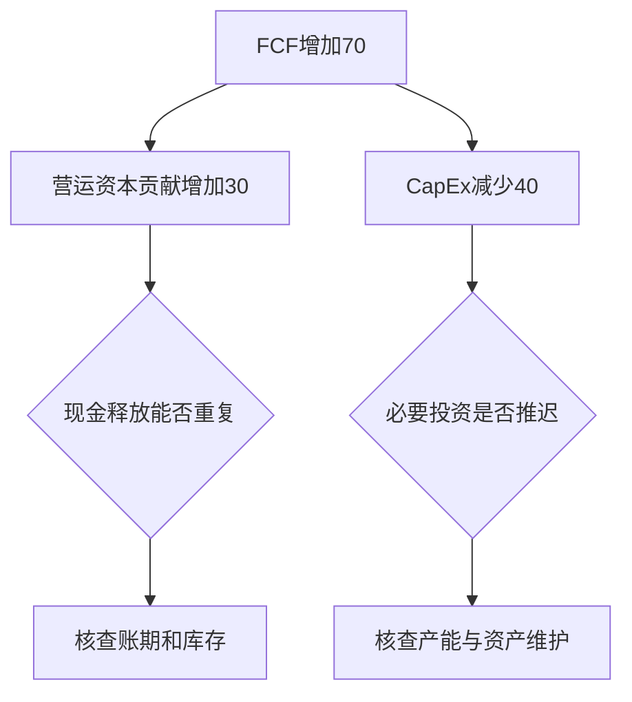
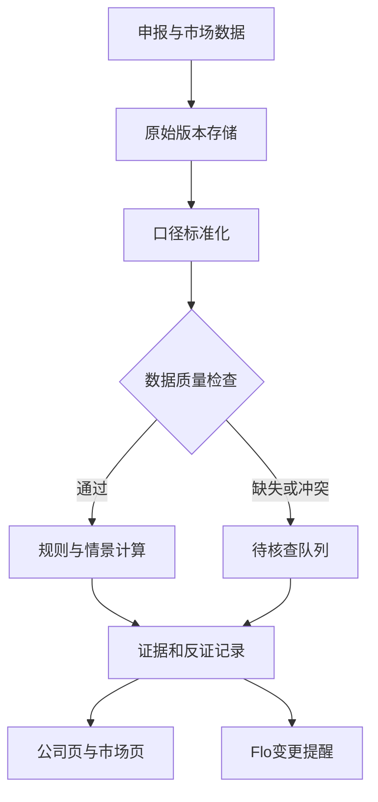

# Filing Flows · Analysis Traps rulebook（分析陷阱规则手册）

**What is live (v1.1, phases P1–P2):** ten rules run on every company with a published quarter, in `pipeline/traps.py`, written
by `scripts/seo_traps.py` with the site: `data/traps/<cik>.json` (every finding), `data/traps/index.json`,
`c/<slug>/analysis-traps/`, a card on each company page, `disclosures/analysis-traps/`, the Hub tab "Analysis traps"
and the company view of the same name, and Flo ("what should I check before trusting NVDA's figures?").
`TRAPS=off` (repository variable) skips the step; the module reads the published files and changes nothing else
(the earnings quality score keeps its weights).

| Rule | Trap | Trigger (v1.1) | Protective conditions | Not applicable / insufficient |
|---|---|---|---|---|
| A01 | FCF growth = the business improved | ΔFCF > 0 over the last two fiscal years and (working-capital release + capex cut) ≥ 50% of ΔFCF; severity high when ≥ 80% and OCF before working capital did not rise | no percentage on a negative or tiny base; confidence medium when the cash bridge's residual > 5% of OCF | financials; fewer than two years with OCF and capex |
| A07 | SBC added back = no economic cost | SBC ≥ 3% of revenue and (diluted shares up > 0.5% or buybacks < SBC); high when SBC ≥ 10% | — | fewer than two years of SBC and share counts; no revenue for the year |
| B02 | Receivables growing = future cash certain | receivables y/y ≥ revenue y/y + 10 pts in each of the last two quarters and DSO ≥ 1.15 × its median over the eight quarters before; one such quarter = "to review" | seasonality, acquisitions and terms are listed as the normal explanations, not tested | financials; fewer than five quarters |
| B08 | Adjusted profit = economic profit | v2: the reconciliation table of each earnings release (`pipeline/release.reconciliation`: GAAP → adjusted net income preferred, then EBITDA/FFO chains; kept only when GAAP + the items = the adjusted figure within 1.5%) stored on the quarter as `nongaap`; with ≥ 3 such quarters, an item excluded in ≥ 3 of the last 4 (names matched after stripping footnote marks and filler words, grouped as stock compensation / amortisation / restructuring / litigation / acquisition / impairments / tax / gains and losses) triggers, confidence medium; high when the recurring items ≥ 30% of GAAP net income over those quarters. Fallback (fewer tables): adjusted (street) EPS ≥ 10% above GAAP in ≥ 3 of the last 4 quarters, confidence low; 1–2 = "to review" | amortisation of acquired intangibles, a dated programme and a single judgement are listed as the normal explanations; definitional EBITDA items (interest, depreciation) never count | fewer than three reconciliations and fewer than three quarters with both EPS figures |
| C02 | Low net debt = no refinancing risk | debt due within a year (maturity table, else the current portion) > cash and investments + max(0, FCF over twelve months); high when covered < 75% | no credit lines assumed (listed as missing evidence); interest never double-counted | no debt; no maturity table and no current portion; a filer whose debt could not be read ("no debt tagged") is insufficient, not clear |
| D03 | EPS growth = profit growth | EPS ≥ +5% y/y while net income ≤ +2% and diluted shares ≤ −1%; the bridge attributes profit first, then the share count | the buyback price against value is listed as missing evidence | a loss in either quarter; no driver record |
| E02 | Low P/E at the cycle peak = cheap | P/E (market cap ÷ trailing net income) ≤ 12 while the last two years are the peak of an eight-year window that holds ≥ 2 down years; the mid-cycle P/E (on the eight-year average profit) is shown beside it; a steady grower is clear | the peak is judged on the window only; confidence medium | financials (J06 instead); fewer than six years of net income; no market cap |
| E07 | The DCF's point value = the value | always "to review" when a DCF is published: shows the terminal-value share and the swing of the two largest tornado inputs; `watch` high when the terminal value ≥ 70% of the value or the swing ≥ 40% | — | no valuation file |
| J06 | A bank's record profit = a normal year | banks only: ROE at the peak of the window with ≥ 1 down year in eight, provisions as the missing evidence; confidence low | — | non-banks |
| J08 | A REIT's dividend = covered by profit | REITs (SIC 6798) only: dividends paid > operating cash flow over the fiscal year, or > 90% = "to review" | FFO/AFFO are listed as the measures to read | non-REITs; no dividend or OCF |

Statuses: `triggered`, `review`, `clear`, `insufficient_data`, `not_applicable`, `expired` (latest filing > 455 days).
Missing data is never shown as clear; severity and confidence are separate fields; findings in one overlap group
(cash_conversion: A01 + B02; share_count: A07 + D03; cycle: E02 + J06) count once in the priority list. Thresholds are starting points;
every finding carries its figures, so a reader can apply stricter ones. False positives and negatives found in review go
in this file's log below.

**Evidence changes (P3):** `scripts/seo_traps.py --store store` keeps each company's last findings in the data branch
(`traps-state.json`) and logs, in `traps-changes.json` / `data/traps/changes.json`, every rule whose status or severity
changed between two filings (newly triggered, no longer triggered, severity changed, now to review, no longer checkable);
a status that flips without a newer filing (a rule upgrade) is not logged. Shown on `disclosures/analysis-traps/#changes`,
the Hub tab, the company view, Flo ("which traps changed with the latest filings?") and Flo's pulse feed (kind `trap`,
cited to the filing).

**Review log**
- 2026-11-05 v1.1: E02, E07, J06, J08 added (E02 first flagged steady growers such as NVDA and META → ≥ 2 down years
  required; fiscal years older than the latest quarter's year − 2 are dropped from every rule's inputs, after Boston
  Properties' FY2010–2014 rows). B08 v2 reads the releases' reconciliation tables (checked on Visa's cross-table and
  Host's EBITDA → EBITDAre chain); the tables accumulate from the next scans, so most companies stay on the EPS-gap
  stand-in (confidence low) until three releases are on file.
- 2026-11-05 v1.0: rules A01, A07, B02, B08, C02, D03 live. Checked by hand on 19 large companies (AAPL, AMZN, GM,
  TSLA, ABT, CRM, DIS, INTC triggered at least one). Known limits: B08 has data for few companies (the earnings
  research holds adjusted EPS for a subset); D03 needs the driver record (missing for some filers, e.g. JNJ); C02 cannot
  see undrawn facilities.

---

The catalogue and development outline below are the owner's design document (2026-11-05), kept verbatim as the
roadmap: the hundred traps, the visualisations, the data conventions, the phases and the tests.

# Filing Flows：分析陷阱图谱与开发大纲

版本：1.0｜2026-11-05｜范围：上市公司财务、估值、市场、基金、宏观与研究方法。

本文是一份可扩展的研究分类和产品设计，不声称穷尽所有陷阱。部分 trap 名称是描述性标签，并非标准术语。全部数字案例均为教学假设。未检查当前仓库，以下目录、接口与集成均为建议，不代表现有功能或已完成开发。

## 1. 产品原则

目标：把“这个数字为什么可能误导我”变成可验证的问题。异常信号不是舞弊结论，不直接转换为买卖建议或股价预测。

每个提示至少回答：观察到什么、为何值得关注、还有什么正常解释、需要什么证据、何时失效。

显示五种状态：触发、未触发、数据不足、不适用、待复核。另设已过期状态；数据不足不能显示绿色安全。严重性与证据置信度分开。低 FCF、高估值、SBC 或采购承诺本身均不等于风险事件。

## 2. 陷阱目录：100项

表中“核查与分析意见”同时给出检测方向及主要正常解释；所有阈值均需按行业、季节和历史校准。

### A. 现金流与资本投入

| ID | 陷阱与误判 | 核查与分析意见 | 可视化 |
|---|---|---|---|
| A01 | FCF增长＝经营改善 | 拆CFO、营运资本与CapEx；投资延期也会抬高FCF | FCF变化瀑布图 |
| A02 | 低FCF＝差公司 | 分清扩张投资与维持投资；检验新增产能回报 | 投资批次回报曲线 |
| A03 | 清库存带来现金＝可持续 | 比较销量、采购与库存；合理去库存可能只释放一次现金 | 库存与现金桥 |
| A04 | 拖延付款＝现金能力强 | DPO与供应商条款、逾期和融资项目核对 | 应付账龄热图 |
| A05 | 应收保理＝客户回款改善 | 查出售应收规模、追索权、费用和现金流分类 | 应收回收来源堆叠 |
| A06 | 客户预付款＝已赚到利润 | 仍有交付、退款和成本义务；持续增长时可形成合理融资 | 预收与履约时间线 |
| A07 | SBC加回＝没有经济成本 | 看稀释股数与抵消稀释的回购；估值避免重复扣减 | 股数桥与SBC趋势 |
| A08 | 现金CapEx＝全部资本投入 | 核查融资租赁、非现金购置与延期支付 | 现金/非现金投入分层 |
| A09 | 收购型增长的FCF很高 | 常见FCF不扣并购；评估维持增长所需收购支出 | 有机FCF与并购现金图 |
| A10 | 税款退款抬高CFO＝经营强 | 区分一次性退税、纳税时点和正常税负 | 现金税与税费对照 |

### B. 收入、利润与会计判断

| ID | 陷阱与误判 | 核查与分析意见 | 可视化 |
|---|---|---|---|
| B01 | 营收增长＝终端需求增长 | 查渠道库存、退货及sell-through；季节性可能合理 | 收入/渠道库存对照 |
| B02 | 应收增长＝未来现金确定 | DSO、信用条款、账龄与坏账；新业务结构可能解释 | 收入与应收指数图 |
| B03 | 合同资产＝已可收款 | 收款可能有验收条件；核查合同与转应收速度 | 合同资产转换漏斗 |
| B04 | 总额收入可直接比净额收入 | 主理人/代理人确认使收入不可比 | 净额口径重排图 |
| B05 | 资本化带来利润率改善 | 比较费用资本化率、摊销与减值；符合准则不等于不需调整 | 支出到利润桥 |
| B06 | 准备金释放＝业务复苏 | 对账计提、使用和转回；合理估计更新可能成立 | 准备金滚动瀑布 |
| B07 | 延长折旧年限＝效率提升 | 复核资产寿命、替换周期与减值 | 折旧政策敏感性 |
| B08 | 调整后利润＝经济利润 | 检查反复被剔除的重组、诉讼、整合成本 | GAAP到调整后桥 |
| B09 | 低有效税率永久持续 | 区分税收优惠、估值备抵释放和地域利润结构 | 税率桥及到期线 |
| B10 | 利润增长均来自主业 | 分拆投资收益、出售资产、养老金收益 | 主业与非主业贡献 |

### C. 资产负债、流动性与隐藏义务

| ID | 陷阱与误判 | 核查与分析意见 | 可视化 |
|---|---|---|---|
| C01 | 现金多＝可随时偿债 | 查受限现金、主体归属与运营最低现金 | 可用现金分层条 |
| C02 | 净债务低＝没有再融资风险 | 近期到期集中、现金不可跨主体转移仍有风险 | 现金与到期墙 |
| C03 | 高流动比率＝资产可变现 | 存货滞销、应收坏账影响变现 | 流动资产折价情景 |
| C04 | 账面净资产＝清算价值 | 商誉、无形资产及专用设备需折价 | 账面到回收价值桥 |
| C05 | 无借款＝无未来付款压力 | 查租赁、担保和采购承诺；避免全部当作债务 | 义务到期分层图 |
| C06 | 供应商融资＝普通应付 | 查融资方、期限、现金流分类与集中撤资风险 | 供应链融资网络 |
| C07 | 联营/SPE不并表＝风险消失 | 查担保、追索权和支持承诺；持股不等于全额负债 | 法律主体风险图 |
| C08 | 净债务/EBITDA低＝杠杆安全 | EBITDA高峰、租赁口径或调整项影响分母 | 中周期杠杆情景 |
| C09 | 固定利率债＝利率无影响 | 再融资成本、浮息债与对冲到期仍需检查 | 利率重定价时间线 |
| C10 | 资产抵押足＝融资可持续 | 抵押折扣、契约和交叉违约可能限制可用额度 | 担保覆盖压力矩阵 |

### D. 盈利能力、增长与资本配置

| ID | 陷阱与误判 | 核查与分析意见 | 可视化 |
|---|---|---|---|
| D01 | ROE上升＝经营改善 | 杠杆、回购、减值均可缩小权益 | 杜邦分解 |
| D02 | ROIC高＝新投资也高回报 | 历史资产低账面值可能夸大；看增量ROIC | 存量/增量ROIC图 |
| D03 | EPS增长＝利润增长 | 分拆利润与稀释股数贡献 | EPS增长瀑布 |
| D04 | 大额回购＝股东受益 | 看净股数、买入估值、融资成本 | 回购金额与净稀释 |
| D05 | 并购收入＝有机增长 | 分离并购、汇率、价格和销量 | 收入增长桥 |
| D06 | 毛利率升＝竞争力增强 | 产品组合、原材料周期和存货计价可解释 | 价格/成本/组合桥 |
| D07 | 高增长＝创造价值 | 增量ROIC低于资本成本可能毁损价值 | 增长×回报差象限 |
| D08 | 规模增长＝单位经济改善 | 单位贡献、获客成本和留存可能恶化 | 客户批次回收曲线 |
| D09 | 成本削减＝永久效率 | 削研发、维护和服务可能牺牲未来 | 成本节约与领先指标 |
| D10 | Backlog＝确定收入 | 查取消权、执行期限、价格调整与产能 | 订单转收入漏斗 |

### E. 估值模型

| ID | 陷阱与误判 | 核查与分析意见 | 可视化 |
|---|---|---|---|
| E01 | 跌得多＝便宜 | 以未来盈利重新估值，不锚定历史高点 | 股价与盈利修正图 |
| E02 | 周期顶部低PE＝低估 | 使用中周期利润和供需情景 | 周期利润估值带 |
| E03 | 亏损公司负PE更低＝更便宜 | 负PE不具常规排序意义；改用现金与盈利路径 | 盈亏路径情景 |
| E04 | 低PB＝安全边际 | 检查资产质量和正常ROE | PB与ROE散点 |
| E05 | 低EV/EBITDA＝高现金回报 | 资本开支、税与营运资本差异显著 | EBITDA到FCF桥 |
| E06 | 同行平均倍数＝合理倍数 | 控制增长、利润率、地域、风险与业务构成 | 匹配同行散点 |
| E07 | DCF精确值＝真实价值 | 展示终值权重与参数范围 | 折现率×增长率热图 |
| E08 | 高终值增长无需再投资 | 增长必须匹配再投资及长期ROIC | 增长/再投资一致性图 |
| E09 | 股权/企业价值口径可混用 | FCFF配WACC与EV；FCFE配股权成本与股权价值 | 估值口径对账表 |
| E10 | 分部估值相加没有遗漏 | 扣公司费用、债务、税、少数股权，避免持股重复 | SOTP瀑布 |

### F. 股息、ETF与投资产品

| ID | 陷阱与误判 | 核查与分析意见 | 可视化 |
|---|---|---|---|
| F01 | 高股息率＝高未来收益 | 价格下跌抬高收益率；检验分红覆盖 | 股价/股息/覆盖图 |
| F02 | 分配率＝投资回报率 | 分配可能含收益、已实现收益或资本返还 | 分配来源与总回报 |
| F03 | 高频派息＝赚得更多 | 周派/月派频率不增加经济回报 | 同口径现金与净值 |
| F04 | 除息前买入＝免费股息 | 除息价格调整与税费影响结果 | 除息事件时间线 |
| F05 | 备兑策略高分配＝低风险高增长 | 权利金伴随上行让渡，下跌保护有限 | 策略到期损益曲线 |
| F06 | 2×/3×ETF长期必等于倍数 | 日重置、复利、成本与路径依赖 | 多路径净值模拟 |
| F07 | 多只ETF＝充分分散 | 底层持仓和因子重叠可能很高 | 穿透持仓矩阵 |
| F08 | ETF价格＝净值 | 折溢价、买卖价差与交易时段差异 | 价格/NAV/价差图 |
| F09 | 历史收益率口径都相同 | SEC yield、TTM、最近分配年化不可混用 | 收益率定义对照 |
| F10 | 资本返还必然侵蚀价值 | 税务ROC不必然等于经济损失；结合总回报与净值 | 税务来源/经济回报双栏 |

### G. 市场信号与交易结构

| ID | 陷阱与误判 | 核查与分析意见 | 可视化 |
|---|---|---|---|
| G01 | 好财报＝必涨 | 比较预期、指引和定价，缺共识数据时明确未知 | 实际/预期/价格事件图 |
| G02 | 指数创新高＝多数公司走强 | 检查市值集中、等权与市场宽度 | 等权/市值权重对照 |
| G03 | 放量＝机构净买入 | 成交有买卖两侧；核查再平衡和事件 | 量价与事件叠图 |
| G04 | 大单＝知情交易 | 可是对冲、被动调仓或组合交易 | 大单与持仓证据时间线 |
| G05 | 资金流入＝方向性看多 | ETF套利和对冲可能解释流入 | 流量/价格/申赎图 |
| G06 | 高空头比例＝必逼空 | 可借量、借券成本、基本面和对冲性质都重要 | 空头与流动性矩阵 |
| G07 | Put/Call高＝必跌 | 多腿、平仓、保护性交易改变含义 | 期权成交分类图 |
| G08 | IV高＝市场预计上涨 | IV描述波动幅度，不能直接给出方向 | 波动微笑与期限结构 |
| G09 | 技术突破＝趋势确立 | 流动性、回踩和市场状态影响可靠性 | 突破事件分布 |
| G10 | 13F新增＝刚刚买入 | 季末快照与披露滞后；不覆盖全部资产及空头 | 持仓日/披露日时间线 |

### H. 宏观、行业与因果

| ID | 陷阱与误判 | 核查与分析意见 | 可视化 |
|---|---|---|---|
| H01 | 降息＝股票必涨 | 区分通胀缓解和衰退冲击 | 增长/通胀情景矩阵 |
| H02 | 相关性＝因果 | 共同驱动、反向因果与滞后需识别 | 因果假设图 |
| H03 | 美元涨对所有公司同向影响 | 收入、成本、债务币种和对冲不同 | 净币种敞口图 |
| H04 | 商品涨价＝生产商利润同比例涨 | 产量、成本、套保与税费变化 | 商品价格到利润桥 |
| H05 | 行业CapEx增长＝所有供应商受益 | 份额、进口、交付滞后和利润率不一致 | CapEx到收入证据网络 |
| H06 | 名义增长＝实际需求增长 | 通胀与数量分开，价格上涨可能掩盖销量下降 | 价格/数量增长桥 |
| H07 | 同比反弹＝持续加速 | 低基数、季节性与工作日差异影响比较 | 同比/环比/两年复合图 |
| H08 | 当前宏观数据就是当时已知数据 | 初值、修订值与发布日期不同 | 数据版本时间线 |
| H09 | 政策宣布＝立即兑现 | 生效日期、覆盖对象和执行约束不同 | 政策到经营传导时间线 |
| H10 | 历史关系可永久外推 | 制度变化、竞争与供应链迁移可能改变机制 | 滚动系数与结构断点 |

### I. 回测、统计与数据

| ID | 陷阱与误判 | 核查与分析意见 | 可视化 |
|---|---|---|---|
| I01 | 只用存活公司回测 | 纳入退市与历史成份 | 样本覆盖审计图 |
| I02 | 使用未来才公开的信息 | 按available_at构建point-in-time数据 | 事件可用性时间线 |
| I03 | 最佳参数＝可泛化规律 | 记录全部尝试，嵌套样本外验证 | 参数热图/样本外表现 |
| I04 | 选择有利起止点 | 多起点滚动窗口与完整区间 | 滚动收益热图 |
| I05 | 高收益＝高alpha | 控制市场、行业、风格和杠杆暴露 | 因子归因图 |
| I06 | 毛收益＝可实现收益 | 计入费用、滑点、借券和容量限制 | 毛到净回报桥 |
| I07 | 价格回报与总回报混用 | 统一股息、拆股、币种和复权口径 | 口径审计表 |
| I08 | 高胜率＝高期望收益 | 小赚大亏可能负期望 | 盈亏分布/尾部图 |
| I09 | 大量重叠样本＝大量独立证据 | 检查序列相关，使用块抽样与有效样本数 | 样本重叠图 |
| I10 | 单一均值代表典型结果 | 展示中位数、分位数、样本数及置信区间 | 分布与区间图 |

### J. 认知、治理与特殊行业

| ID | 陷阱与误判 | 核查与分析意见 | 可视化 |
|---|---|---|---|
| J01 | 只搜支持原观点的证据 | 强制记录反证及观点失效条件 | 多空证据板 |
| J02 | 用历史高点/成本锚定价值 | 独立重建估值与替代机会成本 | 当前假设估值区间 |
| J03 | 明星管理层＝公司一定优质 | 检查承诺兑现、资本配置和关联交易 | 指引兑现时间线 |
| J04 | 内部人卖出＝必有坏消息 | 查计划交易、税务、报酬与剩余持股 | 内部人交易背景卡 |
| J05 | 审计无保留意见＝没有风险 | 审计并不保证未来偿付或杜绝舞弊 | 审计/经营风险分栏 |
| J06 | 银行低PE且利润高＝安全 | 信用周期、存款成本、流动性与资本要求 | 贷款批次/存款压力图 |
| J07 | 保险低赔付率永久持续 | 查准备金发展、巨灾与再保险 | 赔付发展三角 |
| J08 | REIT净利润低＝分红不可持续 | 分析FFO/AFFO口径、维持CapEx与租户质量 | 净利润到可分配现金桥 |
| J09 | SaaS ARR增长＝现金和留存都强 | 口径差异、NRR、折扣、合同期限和收款需核查 | ARR桥/客户批次图 |
| J10 | 生技里程碑或矿产资源＝确定收入 | 临床、审批、融资或开采经济性均有条件 | 概率情景树 |

## 3. 可视化样例与分析意见

### 3.1 FCF质量桥：不要把全部变化归因于经营

假设单位为百万元：去年CFO100、CapEx60、FCF40；今年CFO130、CapEx20、FCF110。已知营运资本的额外现金贡献为30，CapEx减少40。

| FCF变化来源 | 金额 | 可以得出的结论 |
|---|---:|---|
| 去年FCF | 40 | 起点 |
| 营运资本贡献变化 | +30 | 需核查是否可重复 |
| CapEx减少 | +40 | 需核查是否推迟必要投入 |
| 其他CFO净变化 | 0 | 本例没有改善 |
| 今年FCF | 110 | 增加70并不能证明经营盈利改善 |



瀑布图中用蓝色表示现金流来源，橙色表示暂时性待核查因素，灰色表示未知。不要把灰色当零。只有证据证明不可持续才标注为调整项。分析人员应同时展示原始FCF及情景调整区间，不制造唯一“真实FCF”。

### 3.2 EPS增长桥：利润和股数分开

假设净利润连续两年均为100，稀释加权平均股数由100降到80：EPS从1升至1.25，增长25%。采用固定顺序桥接：先按旧股数计算利润变化贡献，再计算股数变化贡献，并披露分解顺序。此例全部增长来自股数。不能据此认定回购无价值，还要看买入价格与融资成本。

### 3.3 周期估值热图

假设股价50，高峰EPS10对应5倍PE；正常EPS2对应25倍PE。热图横轴为EPS情景，纵轴为估值倍数，格内为隐含股价。情景概率在没有依据时留空，不能自动标成概率预测。

### 3.4 杠杆ETF路径示例

假设忽略费用与跟踪误差，指数从100涨10%至110，再跌9.0909%回到100。日度2倍产品从100到120，再到98.1818，累计约-1.82%。日度3倍从100到130再到94.5455，约-5.45%。这说明路径依赖；单边趋势中复利也可能带来超过简单倍数的回报，不能写成“杠杆ETF必然衰减”。

### 3.5 风险与证据双轴

| 潜在影响 | 证据弱 | 证据强 |
|---|---|---|
| 较高 | 优先补证，显示待核查 | 优先深入分析 |
| 较低 | 降低提醒频率 | 常规观察 |

界面不输出“舞弊概率87%”这类未经校准的数字。置信度来自来源可靠性、解析准确性、口径一致性与交叉验证；影响来自金额、持续时间与偿付压力。

## 4. Brainstorm：可扩展产品功能

1. **反证卡**：每个风险提示强制配一条正常解释及可证伪条件。
2. **同一个好数字，两种故事**：如FCF增长分别展示经营改善与投资削减情景。
3. **指标口径翻译器**：FCF、AFFO、ARR、yield等定义并排展示，禁止直接混排。
4. **会计到经济桥**：利润→CFO→FCF→义务后现金情景，保留逐项来源。
5. **期限错配镜头**：资产变现时间与债务付款时间同屏。
6. **经营与股东双视角**：公司总利润、总现金与每股指标同时显示。
7. **周期镜头**：当前、中周期、衰退三组利润和杠杆口径切换。
8. **承诺追踪器**：历史管理层指引与最终结果比较，保留当时可见版本。
9. **宏观传导面板**：利率、汇率、商品价格→收入/成本/债务→利润/现金流，注明假设。
10. **重复风险合并**：把FCF差、营运资本差、应收差合并为同一根因组，避免三次惩罚。
11. **证据变更提醒**：新财报令原提示消失或加重时，解释变化原因。
12. **陷阱训练模式**：先给原始图表，用户选择解释，再显示反证与计算步骤。
13. **投资论点失效清单**：记录用户假设对应的观测条件，按新披露复核。
14. **数据健康面板**：展示覆盖、时效、缺失、重述和解析错误。
15. **预期缺口面板**：实际表现、公开指引、可授权使用的共识并排；无共识不伪造surprise。
16. **危机传导图**：客户集中→应收→现金→契约→再融资，边需要证据与时间方向。
17. **对抗式分析**：同一证据给出多头和空头解释，最终列尚未解决的问题。
18. **行业专属镜头**：银行、保险、REIT、SaaS、生技分别配置规则，不硬套工业企业FCF。

## 5. 数据与计算约定

### 5.1 来源优先级

SEC原始申报及XBRL、公司官方IR与补充报表优先；交易所/指数提供商用于成份和公司行动；市场行情及预期数据使用具备许可的来源。新闻只提供线索，不能替代申报证据。不得声称免费数据源覆盖全部历史成份、退市收益、逐笔交易和分析师预期。

最低历史建议为8个季度，目标20个季度和5年以上年度数据；周期判断常需更长历史。历史不足应降级，不用当前横截面冒充历史。

### 5.2 标准字段

- entity_id、CIK、ticker_valid_from/to、行业、报告币种。
- accession、form、filed_at、accepted_at、period_start/end、available_at、ingested_at。
- 原始tag、标准指标、dimensions、单位、scale、原始值、标准化值、mapping_version。
- source_url、section、page_if_available、原文短摘、content_hash、parser_version。
- 原始披露版本与重述版本均保留；缺失值用null及reason，不用0。
- 流量与时点项目分开；Q4可由全年减前三季累计得到，并标记derived。
- 累计现金流转换单季必须在相同年度、相同版本及口径下进行。

### 5.3 关键计算

- FCF = CFO − 现金CapEx；另存公司自定义FCF及其调节项。
- ΔFCF = ΔCFO − ΔCapEx。CFO营运资本贡献用现金流表原有符号，不能简单把资产负债变化当作现金变化。
- DSO ≈ 平均应收 / 同期收入 × 同期天数；信用销售不可得时标明代理口径。
- DIO ≈ 平均存货 / COGS × 天数。
- DPO ≈ 平均应付 / 采购额 × 天数；采购额缺失使用COGS代理并注明局限。
- ROIC = NOPAT / 平均投入资本；固定现金、商誉、租赁的处理口径。
- FCFF = EBIT×(1−税率)+D&A−CapEx−Δ经营营运资本。
- FCFE = 净利润+D&A−CapEx−Δ经营营运资本+净借款。
- FCFF用WACC折现，FCFE用股权成本折现；不能把CFO−CapEx直接当作所有公司的FCFF。
- 不在FCF扣减SBC后又无条件完整计入相同稀释成本；选择清楚且一致的估值路径。
- 债务、租赁、担保与采购承诺分别展示，明确重叠与条件，不机械总加。

## 6. 规则引擎设计

### 6.1 规则输出结构

```json
{
  "rule_id": "A01",
  "rule_version": "1.0",
  "entity_id": "DEMO_ONLY",
  "as_of": "2026-11-05",
  "period": "FY_DEMO",
  "status": "triggered",
  "severity": "medium",
  "confidence": "medium",
  "observed": {"fcf_prior": 40, "fcf_current": 110, "delta_wc_cash": 30, "capex_reduction": 40},
  "unit": "USD_millions",
  "explanation": "FCF增加来自营运资本释放和资本开支下降，持续性待核查",
  "alternative_explanations": ["扩张项目已经完工", "供应商合法延长合同账期"],
  "missing_evidence": ["维持性CapEx", "供应商条款"],
  "evidence_ids": [],
  "is_demo": true,
  "overlap_group": "cash_conversion",
  "next_review": "next_filing"
}
```

### 6.2 第一版可执行规则候选

| 规则 | 候选触发条件 | 必要保护条件 | 复核 |
|---|---|---|---|
| A01 | FCF增加且营运资本或CapEx变化贡献显著 | 增幅分母接近0时不报百分比；核对并购和汇率 | 投资是否延期 |
| B02 | 应收增速连续高于收入且DSO偏离历史/同行 | 季节性、并购、收入确认与币种一致 | 信用质量 |
| B08 | 同类调整成本多年度反复出现 | 文本匹配需人工验证；金额需同口径 | 是否经常性 |
| C02 | 未来12月到期额超过可用现金与保守现金流 | 融资额度必须已承诺且可提款；避免重复扣息 | 再融资与契约 |
| D03 | EPS上涨但净利润不涨、股数下降 | 基本/稀释及期间一致，负利润另处理 | 回购经济性 |
| E02 | 低PE同时利润率处历史高位 | 行业适用；足够历史；结构增长例外 | 中周期利润 |
| F01 | 分配超过同口径可持续现金生成 | REIT/金融使用专属规则；区分股息与分配 | 削减概率不自动量化 |
| G02 | 市值指数强于等权且宽度弱 | 同一股票池与日期；不要推导必然下跌 | 集中程度 |
| I02 | 特征available_at晚于决策时间 | 精确处理时区及盘后发布 | 阻止回测运行 |
| I07 | 比较双方回报/币种口径不同 | corporate actions核查 | 阻止比较发布 |

“显著”先使用可配置的历史分位和行业分位，不采用未经验证的统一风险阈值。规则开发必须记录假阳性和假阴性。异常分位不是违约概率。

## 7. 页面与可视化规格

### 公司页：Analysis Traps面板

首屏显示最多3条优先核查事项、证据置信度、数据截止时间与覆盖度。展开后显示图、计算、来源和正常解释。完整目录可筛选：财务/估值/债务/增长，触发/未知/已解除。

### 研究工作台

左侧选择公司和期间，中部显示一张主图，右侧证据与反证。提供“原始口径/统一口径/情景假设”三个明确标签；假设图不能与事实曲线混为一体。

### 市场页

等权与市值指数、市场宽度、行业贡献、ETF穿透集中度。市场状态仅描述当前观测，不显示未经校准的反转概率。

### 回测审计页

显示成份版本、信息可用时间、退市覆盖、复权口径、交易成本、全部参数尝试、样本外结果与独立样本数。

### 通用图形规则

- 时间、币种、单位、是否TTM、是否调整后必须显示。
- 未知用灰色和文本；红绿之外使用图标与标签。
- 支持键盘操作、数据表替代、移动端与中英切换。
- 导出保留来源、报告期间、生成时间和情景标签。
- 比率分母为零或负值时显示不适用及解释，避免无穷大排行榜。

## 8. 建议架构与接口

实施前先检查现有quality、hidden leverage、公司页、Flo、数据健康与扫描状态模块，形成复用表。保持现有权重与评分不变，新增独立模块和feature flag，先在beta验证。



建议文件：

```text
pipeline/traps/normalize.py
pipeline/traps/features.py
pipeline/traps/engine.py
pipeline/traps/evidence.py
pipeline/traps/rules/*.yaml
api/routes/traps.py
web/traps/
tests/traps/
docs/TRAP_RULEBOOK.md
```

建议数据表：raw_documents、metric_observations、metric_mappings、rule_definitions、trap_findings、finding_evidence、review_events、scan_runs。每条finding唯一键包含实体、报告版本、规则版本与期间，重复执行必须幂等。

建议接口：

- GET /api/companies/{id}/traps?as_of=…
- GET /api/traps/{finding_id}/evidence
- GET /api/companies/{id}/traps/history
- GET /api/market/traps?universe=…&date=…
- GET /api/traps/data-health
- POST /api/traps/{finding_id}/reviews（有权限的人工复核）

保留最近尝试、最近成功、最新来源日期与网站发布时间四个字段。先保存财报结果，再处理价格补充；行情故障不能阻塞财务规则更新。重试与失败队列按数据源分开。

Flo提醒只在新证据、严重性变化或规则解除时出现；按entity+root_cause+period去重。提示采用“请核查”而不是“确认造假”。

## 9. 开发阶段与验收

| 阶段 | 交付 | 验收条件 |
|---|---|---|
| P0 数据审计 | 现有模块盘点、指标字典、原始版本和证据链接 | 每个指标可追溯；缺失不转零；累计/单季正确 |
| P1 财务MVP | A01、A07、B02、B08、C02、D03规则及公司页卡片 | 每条有正常解释、状态和来源；人工样例复核 |
| P2 估值与行业 | 中周期PE、DCF敏感性、银行/REIT例外 | 单位和口径一致；行业适用性自动检查 |
| P3 市场与ETF | 宽度、集中度、分配/回报、杠杆路径 | 历史成份与公司行动可验证；无虚构方向结论 |
| P4 回测审计 | point-in-time、成本、样本外与多重测试记录 | 有泄漏时阻止发布；展示覆盖限制 |
| P5 训练与提醒 | Flo解释、反证训练、证据变更提醒 | 不重复轰炸；可撤销/解除提示；保留审计记录 |

不以100条规则全部自动上线为首期目标。目录里文本依赖、因果推断及特殊行业规则应先人工辅助。

## 10. 测试与研究验证

1. 公式测试：FCF桥对账、EPS股数变化、Q4拆分、拆股和负分母。
2. 数据测试：单位1000倍错位、币种混用、相同tag不同维度、重复披露、重述与时区。
3. 历史回放：仅用当时可见版本，按公司和时间隔离验证集。
4. 人工标注：分别标“指标异常是否准确”和“经济解释是否成立”；双人复核分歧。
5. 误报场景：季节性库存、并购应收增长、正常完工导致CapEx下降、合法账期延长。
6. 回归保护：现有质量评分、指数权重、13F数据与公司页原内容不被新模块覆盖。
7. 展示验收：未知、陈旧与不适用均可见；每张图可下载数表并定位原文。
8. 研究指标：证据覆盖率、解析正确率、提示精确率、误报率、数据时效和人工复核耗时。召回率只有标注集足够完整才报告；不可用之后股价下跌简单定义“财务陷阱为真”。

上线前门槛建议：必备字段与证据链检查全部通过；高严重性提示必须人工复核或拥有足够强的直接证据。数值精确率目标应在基线标注后设定，避免先写一个未经测量的99%。

## 11. 分析人员操作清单

每次至少完成：定义指标→拆变化来源→查可持续性→查代价承担者→查行业例外→查市场预期→写反证→说明缺失数据。

结论模板：

> 本期观察到【事实及金额】。其变化主要来自【已验证来源】。这可能意味着【条件性解释】，但【正常解释】也能导致相同现象。当前缺少【证据】；应在【下一披露/条件】复核。该信号对【现金、估值或偿付】的影响为【情景范围】，目前不支持推导确定股价方向。

## 12. 来源与依据边界

以下官方资料支持核心概念；100项目录和产品方案是分析框架与开发建议，并非每个标签都来自官方命名。法规和具体会计处理实施时应按适用准则重新核查。

1. SEC Non-GAAP Financial Measures，尤其Question 102.07：FCF定义不统一，不能直接代表可自由支配现金。
   https://www.sec.gov/rules-regulations/staff-guidance/corporation-finance-interpretations/non-gaap-financial-measures
2. SEC Financial Reporting Manual Topic 8：非GAAP指标与调节。
   https://www.sec.gov/about/divisions-offices/division-corporation-finance/financial-reporting-manual/frm-topic-8
3. Investor.gov Updated Investor Bulletin: Leveraged and Inverse ETFs：日重置与多日路径依赖。
   https://www.investor.gov/introduction-investing/general-resources/news-alerts/alerts-bulletins/investor-alerts/sec
4. FINRA Defining the Value of an Investment：收益率与估值陷阱。
   https://syndication.finra.org/content/defining-value-investment
5. FINRA Value Investing：低估值与基本面恶化。
   https://syndication.finra.org/content/value-investing
6. S&P Dow Jones Indices SPIVA Scorecards: An Overview：幸存者偏差与基准匹配。
   https://www.spglobal.com/spdji/en/education/article/spiva-scorecards-an-overview/

本文件交付范围为研究目录、可视化规格和开发大纲；未修改或部署Filing Flows网站。
